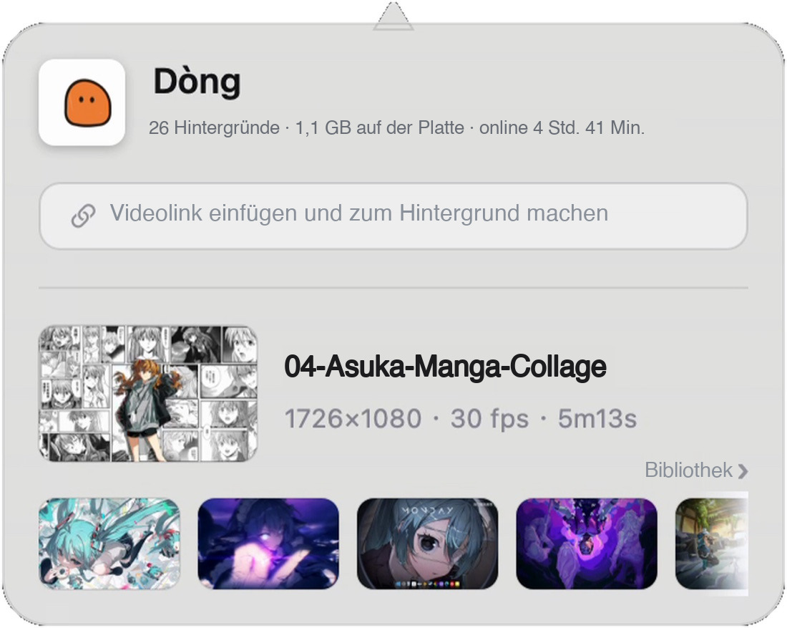
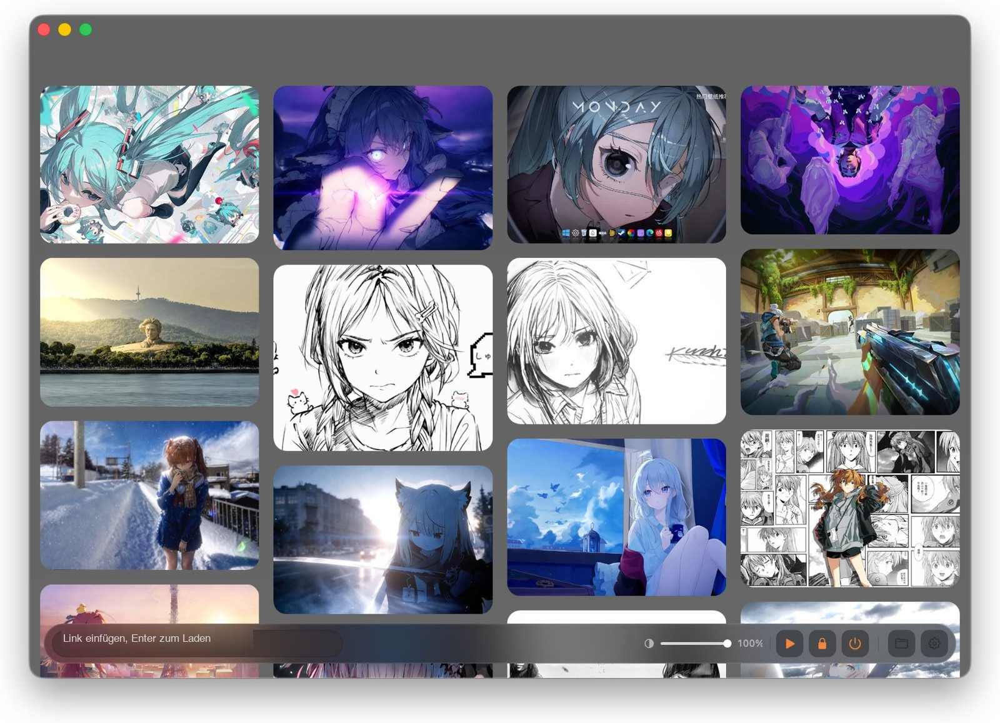

<div align="center">
  
  <h1><b>Dòng</b></h1>
  <p>Jedes Video wird zum lebendigen Desktop.<br>
  <a href="#funktionen"><strong>Dòng entdecken »</strong></a><br><br>
  <a href="#installation">Download für macOS</a> · <a href="https://dongisgood.coze.site/en">Offizielle Website ↗</a><br>
  <a href="i18n/de/AI_INSTALL_PROMPT.md"><strong>🤖 Von einer KI installieren lassen (am einfachsten) »</strong></a><br>
  <i>~ Version 3.31 · macOS 13 und neuer · Apple Silicon ~</i></p>
  <p>
    <a href="README.en.md">English</a> · <a href="README.zh.md">简体中文</a> · <a href="README.ja.md">日本語</a> · <a href="README.ko.md">한국어</a> · <a href="README.fr.md">Français</a><br>
    <b>Deutsch</b> · <a href="README.es.md">Español</a> · <a href="README.it.md">Italiano</a> · <a href="README.ru.md">Русский</a>
  </p>
  <p><sub>Alle Inhalte dieser Seite — Screenshots, verlinkte Dokumente und der Prompt — sind auf Deutsch.</sub></p>
</div>

> [!NOTE]
>
> Dòng ist ein macOS-Live-Wallpaper-Tool, vollständig in Swift und AppKit geschrieben — etwa 8.500 Zeilen Code, null Frameworks von Dritten.
> Kein Electron, kein SwiftUI, kein einziger Pod.
> Einen Video-Link einfügen oder ein lokales Video reinziehen: Download, Zuschnitt und nahtlose Schleife laufen automatisch und landen auf dem Desktop.

<h6 align="center">
  <a href="i18n/de/AI_INSTALL_PROMPT.md"></a>
  <a href="https://github.com/zhang-1-kael/dong/blob/main/LICENSE"></a>
  <a href="https://github.com/zhang-1-kael/dong/releases"></a>
  <a href="https://github.com/zhang-1-kael/dong"></a>
  <a href="https://github.com/zhang-1-kael/dong"></a>
  <a href="https://github.com/zhang-1-kael/dong/stargazers"></a>
  <a href="https://github.com/zhang-1-kael/dong/issues"></a>
</h6>

---

## 🤖 Keine Lust auf manuelle Installation? Schick das an eine KI

> [!IMPORTANT]
> **Der einfachste Weg zu Dòng: eine Nachricht an eine KI.** Kopiere den folgenden Block in einen Assistenten, der Befehle auf deinem Mac ausführen kann (WorkBuddy, Claude Code, Cursor, Codex, ...).
>
> Sie lädt das offizielle DMG, prüft die SHA256, installiert die App in Programme und erledigt die einmalige Bestätigung von macOS beim ersten Start — danach genügt ein Doppelklick.
>
> Du musst weder ein Terminal öffnen noch in den Systemeinstellungen suchen.
>
> Der Prompt unten ist absichtlich auf Englisch, damit ihn jedes KI-Werkzeug versteht. Die letzte Zeile verlangt eine Antwort auf Deutsch — du liest also durchgehend Deutsch.

**① Kopiere diesen ganzen Block**

```text
Please install Dòng, a macOS live wallpaper app, on this Mac.

Official repo: https://github.com/zhang-1-kael/dong
Official site: https://dongisgood.coze.site/en
AI installation manual: AI_INSTALL.md in that repo; one-shot installer: install.sh

Please read the manual and the script first, then follow the manual: download from the official stable endpoint, verify the SHA256 from the official release endpoint, install into /Applications, complete macOS's one-time first-open confirmation, launch the app, and report the result plus how to use it.
Use only the official hosts above; no sudo, no deleting or overwriting my files, no changes to system-wide security settings. If you have no terminal access, just give me the shortest copy-pasteable commands — do not claim you installed anything.
Reply to me in German.
```

**② In die KI einfügen und fertig. Die Auswahl beim ersten Start («Live-Wallpaper aktivieren?») treffe ich selbst.**

📖 Mehr dazu: [vollständiges Handbuch für KIs](i18n/de/AI_INSTALL.md) · [zweisprachige Prompts](i18n/de/AI_INSTALL_PROMPT.md) · [Installationsskript](install.sh) · [manueller Download](https://dongisgood.coze.site/en) · [Alle Dokumente auf Deutsch](i18n/de/GUIDE.md)

---

## Funktionen

### 🖥 Live-Wallpaper auf Desktop-Ebene

Ein randloses Fenster auf der Desktop-Ebene des WindowServer, geloopt mit `AVPlayerLayer`.
Das System-Wallpaper bleibt unberührt, keine Kernel-Erweiterung, keine Admin-Rechte nötig. Jeder Bildschirm bekommt eigenes Fenster und eigenen Player; beim An- und Abstecken von Monitoren bauen sich die Fenster automatisch neu auf.

### 🔗 Link → Wallpaper

Einen Bilibili- / YouTube-Link einfügen, und die gesamte Kette — Download, Transcoding, Feinabstimmung, Import — läuft automatisch.
Douyin-Links werden von der Anti-Scraping-Schranke der Plattform blockiert (siehe [Bekannte Einschränkungen](#bekannte-einschränkungen)); das Video zuerst lokal speichern, dann reinziehen.

### ✂️ Automatisch zur nahtlosen Schleife

ffmpeg rechnet die Bewegtheit des Bildes in ein 1-D-Signal; Sprünge im Signal verraten, wo der eigentliche Inhalt beginnt.
Plattform-Wasserzeichen werden über Helligkeit, Seitenverhältnis und Kantendichte geortet und mit `delogo`-Interpolation ausgebessert.
Eine 0,4-Sekunden-Crossfade zwischen Ende und Anfang lässt den Schleifenpunkt vollständig verschwinden.

### 🎛 Glas-Panel in der Menüleiste

Eine ständige Menüleisten-App: aktuelles Wallpaper, Plattenbelegung, Online-Zeit; Link einfügen genügt zum Import — alle Controls in AppKit von Hand gezeichnet.

<p align="center">
  
</p>

### 📚 Wasserfall-Wallpaper-Bibliothek

Alle Wallpaper im Cover-Raster; hovern zum Vorab-Ansehen, Klicken zum Wechseln. Lautstärke, Wiedergabesteuerung, aktuelle Frame-Infos — alles auf einem Screen.

<p align="center">
  
</p>

### 🔒 Gleicher Frame auf dem Sperrbildschirm

Einen Frame greifen und als System-Wallpaper setzen — bewegt beim Entsperren, das gleiche Standbild beim Sperren.

---

## Verwendung

### Installation

#### Dòng herunterladen

Die neueste `.dmg` gibt es auf der [offiziellen Website](https://dongisgood.coze.site/en): öffnen und Dòng in „Programme" ziehen.

Der Build ist ad-hoc signiert und nicht notarisiert. Sagt macOS, er sei beschädigt, einmal `xattr -dr com.apple.quarantine "/Applications/Dòng.app"` ausführen und erneut öffnen.

> [!TIP]
> **Oder eine KI macht das.** Kopiere den Prompt aus [AI_INSTALL_PROMPT.md](i18n/de/AI_INSTALL_PROMPT.md) in einen beliebigen KI-Assistenten — er lädt, prüft und installiert Dòng mit einem Befehl.
>
> Lieber selbst bauen? Die Schritte unten brauchen nur die Xcode-Kommandozeilen-Tools.

#### Aus dem Quellcode bauen

**Die einzige Abhängigkeit sind die Xcode-Kommandozeilen-Tools** — die vollständige Xcode-App wird nicht gebraucht:

```bash
xcode-select --install   # überspringen, wenn schon installiert
```

Klonen und direkt kompilieren:

```bash
git clone https://github.com/zhang-1-kael/dong.git
cd dong
./build.sh
open build/VideoWallpaper.app
```

`build.sh` kompiliert die 10 `.swift`-Dateien mit einer einzigen `swiftc`-Zeile zu einer ausführbaren Datei und baut daraus das `.app`.
Das Build ist **ad-hoc signiert** und läuft nur auf der eigenen Maschine; für die Weitergabe an andere führt der Weg über `sign-notarize.sh`.

##### Optionale Komponenten

Beide sind zum Kompilieren nicht nötig — fehlt eine, fällt nur die zugehörige Funktion aus:

| Komponente | Zweck | Installation |
|---|---|---|
| **ffmpeg** | Transcoding, Kopf-/End-Schnitt, Wasserzeichen-Entfernung, Schleife | `brew install ffmpeg`, oder nach `~/.local/bin/ffmpeg` legen |
| **yt-dlp** | Link-Downloads | `brew install yt-dlp`, oder die ausführbare Datei nach `vendor/yt-dlp_macos` legen |

`build.sh` packt jedes gefundene ffmpeg / yt-dlp automatisch ins App-Paket, damit die App auch nach dem Kopieren auf anderen Rechnern funktioniert.

> ⚠️ Dieses Repository enthält **weder die beiden Binaries noch die eingebauten Wallpaper-Assets** — siehe [Lizenz & Assets](#lizenz--assets).

##### Als DMG paketieren

```bash
./package.sh                    # → dist/Dòng-<Version>.dmg
VW_NO_PRESETS=1 ./package.sh    # ohne eingebaute Wallpaper, 360 MB kleiner
```

### Wallpaper importieren

1. Auf das Dòng-Symbol in der Menüleiste klicken, um das Panel zu öffnen;
2. Einen Bilibili- / YouTube-Link ins Feld einfügen (ein ganzer Share-Text geht auch — das Programm pickt den Link selbst heraus), Enter drücken;
3. Oder eine lokale Videodatei direkt ins Bibliotheksfenster ziehen;
4. Warten, bis die Pille unten durchläuft — meist 20–60 Sekunden, dann ist das Wallpaper gewechselt.

---

## Architektur

Vier unabhängige Pipelines um eine „Menüleisten-App ohne Fenster":

```
┌──────────────────────────────────────────────────────────────┐
│                Menüleisten-App (LSUIElement)                 │
│                                                              │
│  ① Anzeige     Desktop-Fenster ×N  ──►  AVPlayerLayer  ──►  AVPlayerLooper │
│  ② Pipeline    yt-dlp  ──►  ffmpeg-Transcode  ──►  Bibliothek │
│  ③ Oberfläche  Menüleisten-Panel / Bibliotheksfenster (alles AppKit) │
│  ④ System      LaunchAgent-Autostart · Ordner-Watch · Statistik │
└──────────────────────────────────────────────────────────────┘
```

| Datei | Zeilen | Aufgabe |
|---|---:|---|
| `main.swift` | 1 833 | Anzeigeschicht: Desktop-Fenster, Multi-Display, Player-Lebenszyklus, Auto-Update-Verdrahtung |
| `LibraryWindow.swift` | 2 631 | Bibliotheksfenster, Wasserfall-Layout + Hover-Vorschau + ständiger Transparenz-Regler |
| `Panel.swift` | 1 654 | Menüleisten-Glas-Panel, Jelly-Badge-Animation, alles von Hand gezeichnet |
| `Transcoder.swift` | 672 | Analyse, Zielgröße, Kopf-/End-Erkennung, Wasserzeichen-Entfernung, Encoding |
| `Analytics.swift` | 534 | Anonyme Statistik + Cloud-Service-Adresse (abschaltbar) |
| `Updater.swift` | 515 | Auto-Update: Prüfen, Laden, SHA256-Verifikation, Ersetzen im laufenden Betrieb |
| `Downloader.swift` | 202 | yt-dlp-Wrapper und Fortschritts-Parsing |
| `FrameHealth.swift` | 320 | Ruckel-Wachhund und Wiedergabe-Sonden, schreibt diag.log |
| `LockScreen.swift` | 70 | Frame als System-Wallpaper greifen |
| `Presets.swift` | 47 | Erstimport der eingebauten Assets |

**Die vollständige technische Beschreibung steht in [Technikhandbuch](i18n/de/GUIDE.md)**: warum das Fenster 24pt größer sein muss als der Bildschirm,
warum `--deep`-Signierung schädlich ist, warum Loop-Audio-Mixing in drei Segmenten seeken muss,
warum das handgezeichnete Panel das Milchglas überdeckt — jede Falle ist dokumentiert, samt dem Fehler, der damals dazu führte.

---

## Debugging über die Kommandozeile

Keine Lust, bei jeder Algorithmus-Änderung auf das komplette Transcoding zu warten? Dafür gibt es den headless Einstieg:

```bash
VideoWallpaper --detect a.mp4             # nur Erkennung: Kopf/Ende/Wasserzeichen in 0,2 s
VideoWallpaper --try a.mp4 out.mp4        # ein kompletter Transcode in die angegebene Datei
VideoWallpaper --import a.mp4 b.mp4       # Batch-Import mit Ergebnisausgabe
VideoWallpaper --link "https://…"         # Link-Download + Import
```

Debug-Umgebungsvariablen stehen in Abschnitt 9 von `GUIDE.md` (`VW_PANEL_SHOT`, `VW_GEOM`, `VW_DUMP_MENU` u. a.).

---

## Bekannte Einschränkungen

| Einschränkung | Grund |
|---|---|
| Nur arm64 | Kompilierziel und eingebautes ffmpeg sind Apple Silicon; ein universelles Binary braucht `lipo` |
| Sperrbildschirm ist statisch | macOS öffnet Sperrbildschirm-Videos nicht für Dritte; ein gegriffener Frame ist der einzige Weg ohne Grenzübertritt |
| Multi-Display teilt ein Video | Pro Display ein Player, aber aus derselben Datei |
| Updates vollautomatisch | Prüfen → Laden → SHA256 prüfen → beim Beenden ersetzen und neu starten; nur wenn das scheitert, öffnet sich die dmg |
| Keine Douyin-Links | Douyin setzt `a_bogus`-Anti-Scraping ein und verlangt eingeloggte Cookies; anonyme Requests werden direkt abgewiesen. Das Video zuerst in der App lokal speichern, dann die Datei reinziehen |
| Link-Downloads haben rechtliche Grenzen | Beim Herunterladen von Drittplattformen: nutze nur Material, an dem du Rechte hast |

---

## Datenschutz

Die App enthält eine anonyme Nutzungsstatistik. **Erfasst**: eine zufällig erzeugte Installations-UUID, Versionsnummer, Systemversion,
CPU-Architektur, Sprache, Ereignisname.

**Nicht erfasst**: Dateinamen, Verzeichnispfade, Link-Inhalte, Wallpaper-Bilder, alles persönlich Identifizierbare.
In den Einstellungen mit einem Klick abschaltbar; das Abschalten leert sofort die lokale Warteschlange und stoppt alle Requests.

Die Statistik geht an den Server des Autors (die in `Analytics.swift` fest eingetragene Adresse) und ist **standardmäßig aktiv**.
**Wenn du das Repository forkst und selbst vertreibst, ändere den Standardwert von `isEnabled` in Zeile 50 von `Analytics.swift` auf `false`** —
sonst melden deine Nutzer an den Server des Autors. Dieser Schritt ist nicht fein, muss aber klar gesagt werden.

---

## Lizenz & Assets

Code und Dokumentation stehen unter **GPL-3.0** — siehe [LICENSE](LICENSE). Wer eine geänderte Binärdatei weitergibt, muss den vollständigen zugehörigen Quellcode unter derselben Lizenz bereitstellen.

**Doppellizenzierung:** Für den Einsatz von Dòng in einem quellgeschlossenen kommerziellen Produkt ist eine separate kommerzielle Lizenz erhältlich — siehe [GUIDE.md](i18n/de/GUIDE.md) oder eröffne ein Issue, um den Autor zu kontaktieren.

> **Hinweis zu älteren Versionen:** v3.31 und früher wurden unter der MIT-Lizenz veröffentlicht. Diese Rechte können nicht widerrufen werden; GPL-3.0 gilt nur für spätere Versionen.

**Nicht von der Lizenz abgedeckt:**

- Der Name „Dòng", `AppIcon.icns`, `BrandMark*.png` — Markenzeichen; bitte nicht für Namen oder Icons abgeleiteter Werke verwenden.
- **Wallpaper-Assets**: `presets/` und `bili/` stehen in `.gitignore`; im Repository liegen keine Videodateien.
  Für selbst eingepackte Assets ist das Urheberrecht deine Sache.
- Die `ffmpeg`- und `yt-dlp`-Binaries sind nicht im Repository. Achtung: offizielle ffmpeg-Builds mit
  `--enable-gpl --enable-nonfree` sind **nicht weiterverbreitbar**; für den Vertrieb auf einen LGPL-Build wechseln
  und den Encoder von `libx264` auf `h264_videotoolbox` umstellen.

---

## Über den Autor

I'm a 16-year-old high school sophomore. Dòng started as a whim — I wondered
why a wallpaper couldn't be a moving video, so I wrote one in Swift from
scratch, just for myself.

Then my classmates saw it and wanted it too. So I thought, why not build it
properly and share it. Getting from "it runs on my machine" to "it runs on
yours" meant figuring out downloads, transcoding, code signing, auto-updates —
none of which I had needed to care about before. It was a lot of reading docs
and hitting walls, one small fix at a time.

Now it's open source, and I'm sharing it with everyone. I hope you enjoy using
it — and if you run into any problems or have ideas, please open an issue.
I read every one.

---

<p align="center">
  <sub>Built with swiftc. No frameworks were harmed.</sub>
</p>
