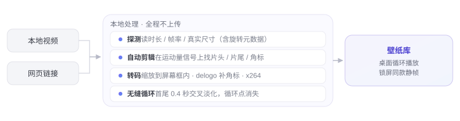

<div align="center">
  
  <h1><b>Dòng</b></h1>
  <p>Turn any video into a living desktop.<br>
  <a href="#features"><strong>Explore Dòng »</strong></a><br><br>
  <a href="#installation">Download for macOS</a> · <a href="https://dongisgood.coze.site/en">Official website ↗</a><br>
  <i>~ Version 3.31 · macOS 13 and later · Apple Silicon ~</i></p>
  <p>
    <b>English</b> · <a href="README.zh.md">简体中文</a> · <a href="README.ja.md">日本語</a> · <a href="README.ko.md">한국어</a> · <a href="README.fr.md">Français</a><br>
    <a href="README.de.md">Deutsch</a> · <a href="README.es.md">Español</a> · <a href="README.it.md">Italiano</a> · <a href="README.ru.md">Русский</a>
  </p>
</div>

> [!NOTE]
>
> Dòng is a macOS live wallpaper tool written entirely in Swift and AppKit — about 8,500 lines of code, zero third-party frameworks.
> No Electron, no SwiftUI, not a single Pod.
> Paste a video link, or drag in a local video: it downloads, trims, and stitches it into a seamless loop, spread across your desktop.

<h6 align="center">
  <a href="https://github.com/zhang-1-kael/dong/blob/main/LICENSE"></a>
  <a href="https://github.com/zhang-1-kael/dong/releases"></a>
  <a href="https://github.com/zhang-1-kael/dong"></a>
  <a href="https://github.com/zhang-1-kael/dong"></a>
  <a href="https://github.com/zhang-1-kael/dong/stargazers"></a>
  <a href="https://github.com/zhang-1-kael/dong/issues"></a>
</h6>

## Features

### 🖥 Desktop-grade live wallpaper

Hang a borderless window on WindowServer's desktop layer and loop it with `AVPlayerLayer`.
It doesn't touch the system wallpaper, needs no kernel extension, and requires no admin rights. Every display gets its own window and player; plug in or unplug a monitor and the windows rebuild automatically.

### 🔗 Link → wallpaper

Paste a Bilibili / YouTube link and the whole chain — download, transcode, fine-tune, import — runs automatically.
Douyin links are blocked by the platform's anti-scraping (see [Known Limitations](#known-limitations)); save the video locally first, then drag it in.

### ✂️ Auto-trimmed into a seamless loop

ffmpeg turns on-screen motion into a 1-D signal; jumps in that signal reveal where the real content starts.
Platform watermarks are located by whiteness, aspect ratio, and edge density, then patched with `delogo` interpolation.
A 0.4-second crossfade between ending and opening erases the loop point completely.

<p align="center">
  
</p>

### 🎛 Menu bar glass panel

A resident menu bar app: current wallpaper, disk usage, online time, paste a link to import — every control hand-drawn in AppKit.

<p align="center">
  
</p>

### 📚 Waterfall wallpaper library

All wallpapers in a cover grid; hover to preview, click to switch. Volume, playback controls, current frame info — all in one screen.

<p align="center">
  
</p>

### 🔒 Same frame on Lock Screen

Grab a frame and set it as the system wallpaper — moving when unlocked, the same still frame when locked.

---

## Usage

### Installation

#### Download Dòng

Grab the latest `.dmg` from the [Releases](https://github.com/zhang-1-kael/dong/releases) page, open it, and drag Dòng into "Applications".

> [!TIP]
> The first official release is being packaged. Until it ships, you can build your own from source with the steps below — all you need is the Xcode command line tools, a minute to install.

#### Build from source

**The only dependency is the Xcode command line tools** — the full Xcode app is not required:

```bash
xcode-select --install   # skip if already installed
```

Clone and compile:

```bash
git clone https://github.com/zhang-1-kael/dong.git
cd dong
./build.sh
open build/VideoWallpaper.app
```

`build.sh` compiles the 10 `.swift` files into a single executable with one `swiftc` line, then assembles the `.app`.
The build is **ad-hoc signed** and only runs on your own machine; distributing it to others requires `sign-notarize.sh`.

##### Optional components

Neither of these is required for compiling — missing one only disables the matching feature:

| Component | Purpose | Install |
|---|---|---|
| **ffmpeg** | Transcoding, trimming head/tail, watermark removal, looping | `brew install ffmpeg`, or drop it in `~/.local/bin/ffmpeg` |
| **yt-dlp** | Link downloads | `brew install yt-dlp`, or drop the executable at `vendor/yt-dlp_macos` |

`build.sh` bundles any ffmpeg / yt-dlp it finds into the app package, so the app still works when copied to another machine.

> ⚠️ This repo does **not** include those two binaries, nor the built-in wallpaper assets — see [License & Assets](#license--assets).

##### Package as DMG

```bash
./package.sh                    # → dist/Dòng-<version>.dmg
VW_NO_PRESETS=1 ./package.sh    # without built-in wallpapers, the DMG is 360 MB smaller
```

### Import a wallpaper

1. Click the Dòng icon in the menu bar to open the panel;
2. Paste a Bilibili / YouTube link into the field (a full share text is fine — the app extracts the link itself), press Enter;
3. Or drag a local video file straight into the library window;
4. Wait for the pill at the bottom to finish — usually 20–60 seconds, and the wallpaper switches.

---

## Architecture

Four independent pipelines around a "menu bar app with no window":

```
┌──────────────────────────────────────────────────────────────┐
│                  Menu bar app (LSUIElement)                  │
│                                                              │
│  ① Display    Desktop windows ×N  ──►  AVPlayerLayer  ──►  AVPlayerLooper │
│  ② Pipeline   yt-dlp  ──►  ffmpeg transcode  ──►  Library   │
│  ③ UI         Menu bar panel / library window (all AppKit)  │
│  ④ System     LaunchAgent autostart · folder watch · stats  │
└──────────────────────────────────────────────────────────────┘
```

| File | Lines | Role |
|---|---:|---|
| `main.swift` | 1 833 | Display layer: desktop windows, multi-display, player lifecycle, auto-update wiring |
| `LibraryWindow.swift` | 2 631 | Library window, waterfall layout + hover preview + resident opacity slider |
| `Panel.swift` | 1 654 | Menu bar glass panel, jelly badge animation, all hand-drawn |
| `Transcoder.swift` | 672 | Probing, target size, head/tail detection, watermark removal, encoding |
| `Analytics.swift` | 534 | Anonymous stats + cloud service endpoint (can be disabled) |
| `Updater.swift` | 515 | Auto-update: check, download, SHA256 verify, replace in place |
| `Downloader.swift` | 202 | yt-dlp wrapper and progress parsing |
| `FrameHealth.swift` | 320 | Stall watchdog and playback probes, writes diag.log |
| `LockScreen.swift` | 70 | Grab a frame as the system wallpaper |
| `Presets.swift` | 47 | First-run import of built-in assets |

**The full technical write-up is in [`技术原理.md`](技术原理.md) (Chinese)**: why the window must be 24pt larger than the screen,
why `--deep` signing is harmful, why loop audio mixing must seek in three segments,
why the hand-drawn panel covers the frosted glass — every pitfall documented, including what went wrong when it was hit.

---

## Command-line debugging

Don't want to wait for a full transcode every time you tweak an algorithm? There's a built-in headless entry point:

```bash
VideoWallpaper --detect a.mp4             # detection only: head/tail/watermark verdicts in 0.2 s
VideoWallpaper --try a.mp4 out.mp4        # one full transcode to a given file
VideoWallpaper --import a.mp4 b.mp4       # batch import, prints results
VideoWallpaper --link "https://…"         # link download + import
```

Debugging environment variables are in section 9 of `技术原理.md` (`VW_PANEL_SHOT`, `VW_GEOM`, `VW_DUMP_MENU`, etc.).

---

## Known Limitations

| Limitation | Reason |
|---|---|
| arm64 only | Build target and bundled ffmpeg are both Apple Silicon; a universal binary needs `lipo` |
| Lock screen is static | macOS doesn't open lock-screen video to third parties; a grabbed frame is the only approach that doesn't cross the line |
| Multi-display shares one video | One player per display, but from the same file |
| Updates fully automatic | Check → download → verify SHA256 → replace in place and relaunch on quit; falls back to opening the dmg only if installation fails |
| No Douyin links | Douyin enforces `a_bogus` anti-scraping and requires logged-in cookies; anonymous requests are rejected outright. Save the video in the app first, then drag the file in |
| Link downloads have legal boundaries | When scraping third-party content, only use material you have the rights to |

---

## Privacy

The app includes anonymous usage statistics. **Recorded**: a randomly generated install UUID, version number, OS version,
CPU architecture, language, event name.

**Not recorded**: file names, directory paths, link contents, wallpaper imagery, anything personally identifiable.
One click in Settings turns it off; turning it off immediately clears the local queue and stops all requests.

Stats are sent to the author's own server (the address hardcoded in `Analytics.swift`) and are **on by default**.
**If you fork this and ship your own build, change the default of `isEnabled` on line 50 of `Analytics.swift` to `false`** —
otherwise your users will report to the author's server. That step isn't polite, but it has to be said plainly.

---

## License & Assets

Code and documentation are licensed under **MIT** — see [LICENSE](LICENSE).

**Not covered by the license:**

- The name "Dòng", `AppIcon.icns`, `BrandMark*.png` — brand marks; please don't use them for derivative names or icons.
- **Wallpaper assets**: `presets/` and `bili/` are in `.gitignore`; there are no video files in this repo.
  The copyright of any assets you bundle yourself is your responsibility.
- The `ffmpeg` and `yt-dlp` binaries are not in this repo. Note: official ffmpeg builds with
  `--enable-gpl --enable-nonfree` **cannot be redistributed**; for distribution, switch to an LGPL build
  and change the encoder from `libx264` to `h264_videotoolbox`.

---

## About

I'm a 16-year-old high school sophomore. Dòng started as a whim — I wondered
why a wallpaper couldn't be a moving video, so I wrote one in Swift from
scratch, just for myself.

Then my classmates saw it and wanted it too. So I thought, why not build it
properly and share it. Getting from "it runs on my machine" to "it runs on
yours" meant figuring out downloads, transcoding, code signing, auto-updates —
none of which I had needed to care about before. It was a lot of reading docs
and hitting walls, one small fix at a time.

Now it's open source, and I'm sharing it with everyone. I hope you enjoy using
it — and if you run into any problems or have ideas, please open an issue.
I read every one.

---

<p align="center">
  <sub>Built with swiftc. No frameworks were harmed.</sub>
</p>
