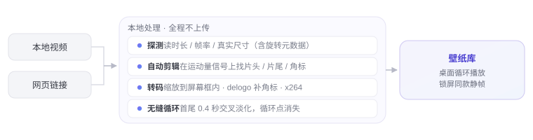

<div align="center">
  
  <h1><b>Dòng</b></h1>
  <p>Convierte cualquier vídeo en un escritorio vivo.<br>
  <a href="#features"><strong>Descubrir Dòng »</strong></a><br><br>
  <a href="#installation">Descargar para macOS</a> · <a href="https://dongisgood.coze.site/en">Sitio web oficial ↗</a><br>
  <i>~ Versión 3.31 · macOS 13 y posteriores · Apple Silicon ~</i></p>
  <p>
    <a href="README.en.md">English</a> · <a href="README.zh.md">简体中文</a> · <a href="README.ja.md">日本語</a> · <a href="README.ko.md">한국어</a> · <a href="README.fr.md">Français</a><br>
    <a href="README.de.md">Deutsch</a> · <b>Español</b> · <a href="README.it.md">Italiano</a> · <a href="README.ru.md">Русский</a>
  </p>
</div>

> [!NOTE]
>
> Dòng es una herramienta de fondos de pantalla animados para macOS escrita íntegramente en Swift y AppKit — unas 8.500 líneas de código, cero frameworks de terceros.
> Nada de Electron, nada de SwiftUI, ni un solo Pod.
> Pega un enlace de vídeo o arrastra un archivo local: la app descarga, recorta y une todo en un bucle sin cortes, extendido sobre tu escritorio.

<h6 align="center">
  <a href="https://github.com/zhang-1-kael/dong/blob/main/LICENSE"></a>
  <a href="https://github.com/zhang-1-kael/dong/releases"></a>
  <a href="https://github.com/zhang-1-kael/dong"></a>
  <a href="https://github.com/zhang-1-kael/dong"></a>
  <a href="https://github.com/zhang-1-kael/dong/stargazers"></a>
  <a href="https://github.com/zhang-1-kael/dong/issues"></a>
</h6>

<a id="features" name="features"></a>

## Características

### 🖥 Fondo animado a nivel de escritorio

Una ventana sin bordes colocada en la capa de escritorio de WindowServer, reproducida en bucle con `AVPlayerLayer`.
No toca el fondo del sistema, no requiere extensiones del kernel ni permisos de administrador. Cada pantalla tiene su propia ventana y su propio reproductor; conectar o desconectar un monitor reconstruye las ventanas automáticamente.

### 🔗 Enlace → fondo

Pega un enlace de Bilibili / YouTube y toda la cadena — descarga, transcodificación, ajuste fino, importación — se ejecuta sola.
Los enlaces de Douyin están bloqueados por la protección anti-scraping de la plataforma (ver [Limitaciones conocidas](#limitaciones-conocidas)); guarda primero el vídeo en local y luego arrastra el archivo.

### ✂️ Recorte automático en un bucle sin cortes

ffmpeg convierte el movimiento en pantalla en una señal 1-D; los saltos de esa señal revelan dónde empieza el contenido real.
Las marcas de agua de las plataformas se localizan por blancura, relación de aspecto y densidad de bordes, y se tapan con interpolación `delogo`.
Un fundido cruzado de 0,4 segundos entre el final y el principio borra por completo el punto de unión.

<p align="center">
  
</p>

### 🎛 Panel de cristal en la barra de menús

Una app residente en la barra de menús: fondo actual, espacio en disco, tiempo en línea, un campo para pegar enlaces — cada control dibujado a mano en AppKit.

<p align="center">
  
</p>

### 📚 Biblioteca de fondos en cascada

Todos los fondos en una cuadrícula de portadas; pasa el cursor para previsualizar, haz clic para cambiar. Volumen, controles de reproducción, información del fotograma actual — todo en una sola pantalla.

<p align="center">
  
</p>

### 🔒 El mismo fotograma en la pantalla de bloqueo

Captura un fotograma y ponlo como fondo del sistema: en movimiento al desbloquear, la misma imagen fija al bloquear.

---

## Uso

<a id="installation" name="installation"></a>

### Instalación

#### Descargar Dòng

Descarga el último `.dmg` desde la página de [Releases](https://github.com/zhang-1-kael/dong/releases), ábrelo y arrastra Dòng a «Aplicaciones».

> [!TIP]
> La primera versión oficial se está preparando. Mientras llega, puedes compilarla tú mismo con los pasos de abajo — solo necesitas las herramientas de línea de comandos de Xcode, un minuto de instalación.

#### Compilar desde el código fuente

**La única dependencia son las herramientas de línea de comandos de Xcode** — no hace falta la app completa de Xcode:

```bash
xcode-select --install   # omítelo si ya están instaladas
```

Clona y compila:

```bash
git clone https://github.com/zhang-1-kael/dong.git
cd dong
./build.sh
open build/VideoWallpaper.app
```

`build.sh` compila los 10 archivos `.swift` en un único ejecutable con una sola línea de `swiftc` y después ensambla el `.app`.
La compilación está **firmada ad-hoc** y solo funciona en tu propio Mac; para distribuirla a otros hay que pasar por `sign-notarize.sh`.

##### Componentes opcionales

Ninguno de los dos es necesario para compilar — si falta uno, solo se desactiva su función:

| Componente | Función | Instalación |
|---|---|---|
| **ffmpeg** | Transcodificación, recorte de inicio/final, eliminación de marcas de agua, bucle | `brew install ffmpeg`, o colócalo en `~/.local/bin/ffmpeg` |
| **yt-dlp** | Descargas por enlace | `brew install yt-dlp`, o coloca el ejecutable en `vendor/yt-dlp_macos` |

`build.sh` empaqueta los ffmpeg / yt-dlp que encuentre dentro de la app, así que sigue funcionando al copiarla a otro Mac.

> ⚠️ Este repositorio **no incluye** esos dos binarios ni los fondos integrados — ver [Licencia y recursos](#licencia-y-recursos).

##### Empaquetar como DMG

```bash
./package.sh                    # → dist/Dòng-<versión>.dmg
VW_NO_PRESETS=1 ./package.sh    # sin los fondos integrados, el DMG pesa 360 MB menos
```

### Importar un fondo

1. Haz clic en el icono de Dòng en la barra de menús para abrir el panel;
2. Pega un enlace de Bilibili / YouTube en el campo (vale un texto de compartir completo — la app extrae el enlace por su cuenta) y pulsa Enter;
3. O arrastra un archivo de vídeo local directamente a la ventana de la biblioteca;
4. Espera a que termine la píldora de abajo — normalmente 20–60 segundos — y el fondo cambia.

---

## Arquitectura

Cuatro tuberías independientes alrededor de una «app de barra de menús sin ventana»:

```
┌──────────────────────────────────────────────────────────────┐
│           App de barra de menús (LSUIElement)                │
│                                                              │
│  ① Pantalla   Ventanas escritorio ×N  ──►  AVPlayerLayer  ──►  AVPlayerLooper │
│  ② Tubería    yt-dlp  ──►  transcode ffmpeg  ──►  Biblioteca │
│  ③ Interfaz   Panel / biblioteca (todo en AppKit)           │
│  ④ Sistema    Arranque LaunchAgent · vigilancia · estadísticas │
└──────────────────────────────────────────────────────────────┘
```

| Archivo | Líneas | Función |
|---|---:|---|
| `main.swift` | 1 833 | Capa de pantalla: ventanas de escritorio, multipantalla, ciclo de vida del reproductor, conexión con las actualizaciones |
| `LibraryWindow.swift` | 2 631 | Ventana de biblioteca, disposición en cascada + vista previa al pasar el cursor + deslizador de opacidad permanente |
| `Panel.swift` | 1 654 | Panel de cristal de la barra de menús, animación del distintivo gelatinoso, todo dibujado a mano |
| `Transcoder.swift` | 672 | Análisis, tamaño objetivo, detección de inicio/final, eliminación de marcas de agua, codificación |
| `Analytics.swift` | 534 | Estadísticas anónimas + endpoint del servicio en la nube (se puede desactivar) |
| `Updater.swift` | 515 | Actualización automática: comprobar, descargar, verificar SHA256, sustituir en el sitio |
| `Downloader.swift` | 202 | Envoltorio de yt-dlp y análisis del progreso |
| `FrameHealth.swift` | 320 | Vigilante de bloqueos y sondas de reproducción, escribe diag.log |
| `LockScreen.swift` | 70 | Capturar un fotograma como fondo del sistema |
| `Presets.swift` | 47 | Primera importación de los recursos integrados |

**La documentación técnica completa está en [`技术原理.md`](技术原理.md) (en chino)**: por qué la ventana debe ser 24 pt más grande que la pantalla,
por qué la firma `--deep` es perjudicial, por qué la mezcla de audio de un bucle debe buscar en tres segmentos,
por qué el panel dibujado a mano cubre el cristal esmerilado — cada trampa está documentada, incluido el error que la provocó.

---

## Depuración por línea de comandos

¿No quieres esperar una transcodificación completa cada vez que ajustas un algoritmo? Hay un punto de entrada sin interfaz:

```bash
VideoWallpaper --detect a.mp4             # solo detección: inicio/final/marca de agua en 0,2 s
VideoWallpaper --try a.mp4 out.mp4        # una transcodificación completa al archivo indicado
VideoWallpaper --import a.mp4 b.mp4       # importación por lotes, imprime los resultados
VideoWallpaper --link "https://…"         # descarga por enlace + importación
```

Las variables de entorno de depuración están en la sección 9 de `技术原理.md` (`VW_PANEL_SHOT`, `VW_GEOM`, `VW_DUMP_MENU`, etc.).

---

## Limitaciones conocidas

| Limitación | Motivo |
|---|---|
| Solo arm64 | Tanto el objetivo de compilación como el ffmpeg incluido son Apple Silicon; un binario universal requiere `lipo` |
| Pantalla de bloqueo estática | macOS no abre el vídeo de la pantalla de bloqueo a terceros; capturar un fotograma es la única vía que no cruza ese límite |
| Varias pantallas comparten un vídeo | Un reproductor por pantalla, pero desde el mismo archivo |
| Actualizaciones totalmente automáticas | Comprobar → descargar → verificar SHA256 → sustituir y reiniciar al salir; solo si falla la instalación se abre el dmg |
| Sin enlaces de Douyin | Douyin aplica el anti-scraping `a_bogus` y exige cookies de sesión; las peticiones anónimas se rechazan de entrada. Guarda primero el vídeo en la app y luego arrastra el archivo |
| Las descargas por enlace tienen límites legales | Al obtener contenido de terceros, usa solo material del que tengas derechos |

---

## Privacidad

La app incluye estadísticas de uso anónimas. **Se registra**: un UUID de instalación aleatorio, número de versión, versión del sistema,
arquitectura de la CPU, idioma, nombre del evento.

**No se registra**: nombres de archivo, rutas de carpetas, contenido de los enlaces, imágenes de los fondos, nada que identifique personalmente.
Un clic en Ajustes las desactiva; al desactivarlas se vacía al instante la cola local y se detienen todas las peticiones.

Las estadísticas se envían al servidor del autor (la dirección escrita en `Analytics.swift`) y están **activas por defecto**.
**Si haces un fork y distribuyes tu propia compilación, cambia el valor por defecto de `isEnabled` en la línea 50 de `Analytics.swift` a `false`** —
si no, tus usuarios enviarán sus datos al servidor del autor. No es algo elegante de decir, pero había que decirlo claro.

---

## Licencia y recursos

El código y la documentación están bajo licencia **MIT** — ver [LICENSE](LICENSE).

**No cubierto por la licencia:**

- El nombre «Dòng», `AppIcon.icns`, `BrandMark*.png` — signos de marca; por favor no los uses para nombres o iconos de obras derivadas.
- **Fondos de pantalla**: `presets/` y `bili/` están en `.gitignore`; no hay archivos de vídeo en el repositorio.
  Los derechos de los recursos que incluyas tú son responsabilidad tuya.
- Los binarios de `ffmpeg` y `yt-dlp` no están en el repositorio. Ojo: las builds oficiales de ffmpeg con
  `--enable-gpl --enable-nonfree` **no se pueden redistribuir**; para distribuir, cambia a una build LGPL
  y sustituye el codificador `libx264` por `h264_videotoolbox`.

---

## About

I'm a 16-year-old high school sophomore. Dòng started as a whim — I wondered
why a wallpaper couldn't be a moving video, so I wrote one in Swift from
scratch, just for myself.

Then my classmates saw it and wanted it too. So I thought, why not build it
properly and share it. Getting from "it runs on my machine" to "it runs on
yours" meant figuring out downloads, transcoding, code signing, auto-updates —
none of which I had needed to care about before. It was a lot of reading docs
and hitting walls, one small fix at a time.

Now it's open source, and I'm sharing it with everyone. I hope you enjoy using
it — and if you run into any problems or have ideas, please open an issue.
I read every one.

---

<p align="center">
  <sub>Built with swiftc. No frameworks were harmed.</sub>
</p>
