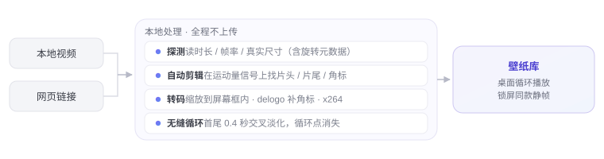

<div align="center">
  
  <h1><b>Dòng</b></h1>
  <p>Transformez n'importe quelle vidéo en bureau vivant.<br>
  <a href="#features"><strong>Découvrir Dòng »</strong></a><br><br>
  <a href="#installation">Télécharger pour macOS</a><br>
  <i>~ Version 3.31 · macOS 13 et versions ultérieures · Apple Silicon ~</i></p>
  <p>
    <a href="README.en.md">English</a> · <a href="README.zh.md">简体中文</a> · <a href="README.ja.md">日本語</a> · <a href="README.ko.md">한국어</a> · <b>Français</b><br>
    <a href="README.de.md">Deutsch</a> · <a href="README.es.md">Español</a> · <a href="README.it.md">Italiano</a> · <a href="README.ru.md">Русский</a>
  </p>
</div>

> [!NOTE]
>
> Dòng est un outil de fonds d'écran animés pour macOS, écrit entièrement en Swift et AppKit — environ 8 500 lignes de code, aucun framework tiers.
> Pas d'Electron, pas de SwiftUI, pas le moindre Pod.
> Collez un lien vidéo ou glissez un fichier local : l'app télécharge, découpe et assemble le tout en une boucle sans rupture, étalée sur votre bureau.

<h6 align="center">
  <a href="https://github.com/zhang-1-kael/dong/blob/main/LICENSE"></a>
  <a href="https://github.com/zhang-1-kael/dong/releases"></a>
  <a href="https://github.com/zhang-1-kael/dong"></a>
  <a href="https://github.com/zhang-1-kael/dong"></a>
  <a href="https://github.com/zhang-1-kael/dong/stargazers"></a>
  <a href="https://github.com/zhang-1-kael/dong/issues"></a>
</h6>

<a id="features" name="features"></a>

## Fonctionnalités

### 🖥 Un fond d'écran animé au niveau du bureau

Une fenêtre sans bordure posée sur la couche « bureau » de WindowServer, lue en boucle par `AVPlayerLayer`.
Le fond d'écran système n'est pas modifié, aucune extension du noyau, aucun droit administrateur requis. Chaque écran a sa propre fenêtre et son propre lecteur ; brancher ou débrancher un moniteur reconstruit les fenêtres automatiquement.

### 🔗 Lien → fond d'écran

Collez un lien Bilibili / YouTube et toute la chaîne — téléchargement, transcodage, réglages fins, import — se lance automatiquement.
Les liens Douyin sont bloqués par la protection anti-scraping de la plateforme (voir [Limites connues](#limites-connues)) ; enregistrez d'abord la vidéo localement, puis glissez le fichier.

### ✂️ Découpe automatique en boucle sans rupture

ffmpeg convertit le mouvement à l'écran en un signal 1-D ; les sauts de ce signal révèlent où commence le vrai contenu.
Les filigranes des plateformes sont repérés par leur blancheur, leur rapport d'aspect et leur densité de contours, puis masqués par interpolation `delogo`.
Un fondu croisé de 0,4 seconde entre la fin et le début efface complètement le point de boucle.

<p align="center">
  
</p>

### 🎛 Panneau vitré dans la barre de menus

Une app résidente dans la barre de menus : fond d'écran actuel, espace disque, temps de connexion, un champ pour coller un lien — chaque contrôle dessiné à la main en AppKit.

<p align="center">
  
</p>

### 📚 Bibliothèque en cascade

Tous les fonds d'écran dans une grille de couvertures ; survolez pour prévisualiser, cliquez pour changer. Volume, contrôles de lecture, infos sur l'image courante — tout sur un seul écran.

<p align="center">
  
</p>

### 🔒 La même image sur l'écran de verrouillage

Capturez une image et définissez-la comme fond d'écran système — animé une fois déverrouillé, la même image fixe une fois verrouillé.

---

## Utilisation

<a id="installation" name="installation"></a>

### Installation

#### Télécharger Dòng

Récupérez la dernière `.dmg` sur la page [Releases](https://github.com/zhang-1-kael/dong/releases), ouvrez-la et glissez Dòng dans « Applications ».

> [!TIP]
> La première version officielle est en cours de préparation. D'ici là, vous pouvez compiler vous-même avec les étapes ci-dessous — seuls les outils en ligne de commande Xcode sont nécessaires, une minute d'installation.

#### Compiler depuis les sources

**La seule dépendance est les outils en ligne de commande Xcode** — l'application Xcode complète n'est pas requise :

```bash
xcode-select --install   # à ignorer s'ils sont déjà installés
```

Clonage et compilation :

```bash
git clone https://github.com/zhang-1-kael/dong.git
cd dong
./build.sh
open build/VideoWallpaper.app
```

`build.sh` compile les 10 fichiers `.swift` en un seul exécutable avec une seule ligne `swiftc`, puis assemble le `.app`.
Le build est **signé ad-hoc** et ne fonctionne que sur votre propre machine ; pour le distribuer, passez par `sign-notarize.sh`.

##### Composants optionnels

Aucun des deux n'est nécessaire à la compilation — s'il en manque un, seule la fonction correspondante est désactivée :

| Composant | Rôle | Installation |
|---|---|---|
| **ffmpeg** | Transcodage, découpe du début et de la fin, suppression des filigranes, boucle | `brew install ffmpeg`, ou le placer dans `~/.local/bin/ffmpeg` |
| **yt-dlp** | Téléchargement par lien | `brew install yt-dlp`, ou placer l'exécutable dans `vendor/yt-dlp_macos` |

`build.sh` intègre les ffmpeg / yt-dlp trouvés dans le paquet de l'app, qui reste fonctionnelle après copie sur une autre machine.

> ⚠️ Ce dépôt **ne contient** ni ces deux binaires, ni les fonds d'écran intégrés — voir [Licence et ressources](#licence-et-ressources).

##### Créer un DMG

```bash
./package.sh                    # → dist/Dòng-<version>.dmg
VW_NO_PRESETS=1 ./package.sh    # sans les fonds intégrés, le DMG est plus léger de 360 Mo
```

### Importer un fond d'écran

1. Cliquez sur l'icône Dòng dans la barre de menus pour ouvrir le panneau ;
2. Collez un lien Bilibili / YouTube dans le champ (un texte de partage complet convient — l'app extrait elle-même le lien), appuyez sur Entrée ;
3. Ou glissez un fichier vidéo local directement dans la fenêtre de la bibliothèque ;
4. Attendez la fin de la pastille en bas — généralement 20 à 60 secondes — et le fond d'écran change.

---

## Architecture

Quatre pipelines indépendants autour d'une « app de barre de menus sans fenêtre » :

```
┌──────────────────────────────────────────────────────────────┐
│              App de barre de menus (LSUIElement)             │
│                                                              │
│  ① Affichage  Fenêtres bureau ×N  ──►  AVPlayerLayer  ──►  AVPlayerLooper │
│  ② Pipeline   yt-dlp  ──►  transcode ffmpeg  ──►  Bibliothèque │
│  ③ Interface  Panneau / bibliothèque (tout en AppKit)        │
│  ④ Système    Démarrage LaunchAgent · veille dossier · stats │
└──────────────────────────────────────────────────────────────┘
```

| Fichier | Lignes | Rôle |
|---|---:|---|
| `main.swift` | 1 833 | Couche d'affichage : fenêtres bureau, multi-écran, cycle de vie du lecteur, câblage des mises à jour |
| `LibraryWindow.swift` | 2 631 | Fenêtre de bibliothèque, disposition en cascade + aperçu au survol + curseur d'opacité permanent |
| `Panel.swift` | 1 654 | Panneau vitré de la barre de menus, animation du badge gélatineuse, tout dessiné à la main |
| `Transcoder.swift` | 672 | Analyse, taille cible, détection du début/fin, suppression des filigranes, encodage |
| `Analytics.swift` | 534 | Statistiques anonymes + point d'accès au service cloud (désactivable) |
| `Updater.swift` | 515 | Mise à jour auto : vérification, téléchargement, contrôle SHA256, remplacement sur place |
| `Downloader.swift` | 202 | Wrapper yt-dlp et analyse de la progression |
| `FrameHealth.swift` | 320 | Chien de garde des ralentissements et sondes de lecture, écrit diag.log |
| `LockScreen.swift` | 70 | Capture d'une image comme fond d'écran système |
| `Presets.swift` | 47 | Premier import des ressources intégrées |

**La documentation technique complète est dans [`技术原理.md`](技术原理.md) (en chinois)** : pourquoi la fenêtre doit dépasser l'écran de 24 pt,
pourquoi la signature `--deep` est nuisible, pourquoi le mixage audio d'une boucle doit se faire en trois segments,
pourquoi le panneau dessiné à la main recouvre le verre dépoli — chaque piège est documenté, avec l'erreur qui l'a provoqué.

---

## Débogage en ligne de commande

Pas envie d'attendre un transcodage complet à chaque réglage d'algorithme ? Il existe un point d'entrée sans interface :

```bash
VideoWallpaper --detect a.mp4             # détection seule : début/fin/filigrane en 0,2 s
VideoWallpaper --try a.mp4 out.mp4        # un transcodage complet vers le fichier indiqué
VideoWallpaper --import a.mp4 b.mp4       # import par lot, affiche les résultats
VideoWallpaper --link "https://…"         # téléchargement par lien + import
```

Les variables d'environnement de débogage se trouvent à la section 9 de `技术原理.md` (`VW_PANEL_SHOT`, `VW_GEOM`, `VW_DUMP_MENU`, etc.).

---

## Limites connues

| Limite | Raison |
|---|---|
| arm64 uniquement | La cible de compilation et le ffmpeg intégré sont Apple Silicon ; un binaire universel demande `lipo` |
| Écran de verrouillage statique | macOS n'ouvre pas la vidéo de l'écran de verrouillage aux tiers ; capturer une image est la seule approche qui ne franchit pas cette limite |
| Plusieurs écrans partagent une vidéo | Un lecteur par écran, mais à partir du même fichier |
| Mises à jour entièrement automatiques | Vérification → téléchargement → contrôle SHA256 → remplacement et relance à la fermeture ; le DMG ne s'ouvre qu'en cas d'échec |
| Pas de liens Douyin | Douyin impose l'anti-scraping `a_bogus` et exige des cookies de connexion ; les requêtes anonymes sont rejetées. Enregistrez d'abord la vidéo dans l'app, puis glissez le fichier |
| Le téléchargement par lien a des limites légales | En récupérant du contenu tiers, n'utilisez que des fichiers dont vous détenez les droits |

---

## Confidentialité

L'app inclut des statistiques d'usage anonymes. **Enregistré** : un UUID d'installation aléatoire, le numéro de version, la version du système,
l'architecture du processeur, la langue, le nom de l'événement.

**Non enregistré** : noms de fichiers, chemins de dossiers, contenu des liens, images des fonds d'écran, toute donnée personnelle.
Un clic dans les Réglages les désactive ; la désactivation vide immédiatement la file locale et stoppe toutes les requêtes.

Les statistiques partent vers le serveur de l'auteur (l'adresse codée en dur dans `Analytics.swift`) et sont **activées par défaut**.
**Si vous forkez ce dépôt et distribuez votre propre build, passez la valeur par défaut de `isEnabled` à la ligne 50 de `Analytics.swift` sur `false`** —
sinon vos utilisateurs enverront leurs données au serveur de l'auteur. Ce n'est pas très élégant à dire, mais il fallait le préciser clairement.

---

## Licence et ressources

Le code et la documentation sont sous licence **MIT** — voir [LICENSE](LICENSE).

**Non couverts par la licence :**

- Le nom « Dòng », `AppIcon.icns`, `BrandMark*.png` — signes de marque ; merci de ne pas les réutiliser pour les noms ou les icônes d'œuvres dérivées.
- **Fonds d'écran** : `presets/` et `bili/` figurent dans `.gitignore` ; le dépôt ne contient aucun fichier vidéo.
  Les droits des ressources que vous intégrez vous-même relèvent de votre responsabilité.
- Les binaires `ffmpeg` et `yt-dlp` ne sont pas dans le dépôt. Attention : les builds officiels de ffmpeg avec
  `--enable-gpl --enable-nonfree` **ne peuvent pas être redistribués** ; pour une distribution, passez à un build LGPL
  et remplacez l'encodeur `libx264` par `h264_videotoolbox`.

---

## About

I'm a 16-year-old high school sophomore. Dòng started as a whim — I wondered
why a wallpaper couldn't be a moving video, so I wrote one in Swift from
scratch, just for myself.

Then my classmates saw it and wanted it too. So I thought, why not build it
properly and share it. Getting from "it runs on my machine" to "it runs on
yours" meant figuring out downloads, transcoding, code signing, auto-updates —
none of which I had needed to care about before. It was a lot of reading docs
and hitting walls, one small fix at a time.

Now it's open source, and I'm sharing it with everyone. I hope you enjoy using
it — and if you run into any problems or have ideas, please open an issue.
I read every one.

---

<p align="center">
  <sub>Built with swiftc. No frameworks were harmed.</sub>
</p>
