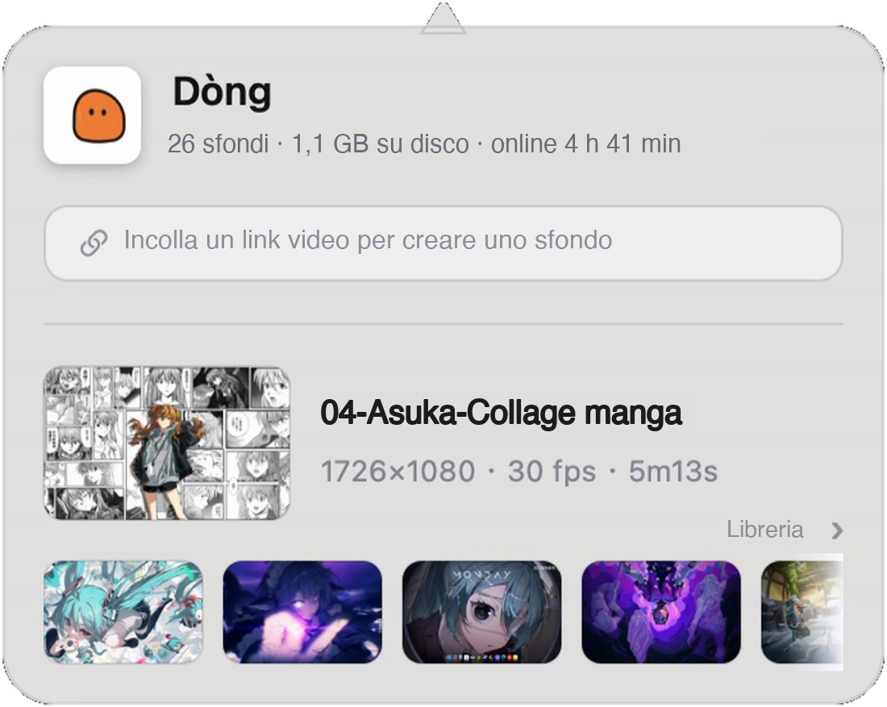
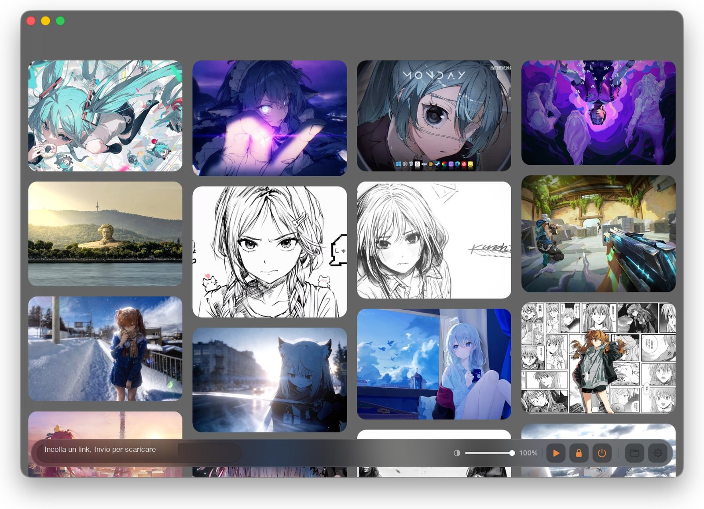

<div align="center">
  
  <h1><b>Dòng</b></h1>
  <p>Trasforma qualsiasi video in una scrivania viva.<br>
  <a href="#funzionalità"><strong>Scopri Dòng »</strong></a><br><br>
  <a href="#installazione">Scarica per macOS</a> · <a href="https://dongisgood.coze.site/en">Sito ufficiale ↗</a><br>
  <a href="i18n/it/AI_INSTALL_PROMPT.md"><strong>🤖 Lascia installare a un'IA (il modo più semplice) »</strong></a><br>
  <i>~ Versione 3.36 · macOS 13 e successivi · Apple Silicon ~</i></p>
  <p>
    <a href="README.en.md">English</a> · <a href="README.zh.md">简体中文</a> · <a href="README.ja.md">日本語</a> · <a href="README.ko.md">한국어</a> · <a href="README.fr.md">Français</a><br>
    <a href="README.de.md">Deutsch</a> · <a href="README.es.md">Español</a> · <b>Italiano</b> · <a href="README.ru.md">Русский</a>
  </p>
  <p><sub>Tutti i contenuti di questa pagina — screenshot, documenti collegati e prompt — sono in italiano.</sub></p>
</div>

> [!NOTE]
>
> Dòng è uno strumento per sfondi animati su macOS scritto interamente in Swift e AppKit — circa 8.500 righe di codice, zero framework di terze parti.
> Niente Electron, niente SwiftUI, nemmeno un Pod.
> Incolla un link video o trascina un file locale: l'app scarica, ritaglia e unisce il tutto in un loop senza soluzione di continuità, disteso sulla tua scrivania.

<h6 align="center">
  <a href="i18n/it/AI_INSTALL_PROMPT.md"></a>
  <a href="https://github.com/zhang-1-kael/dong/blob/main/LICENSE"></a>
  <a href="https://github.com/zhang-1-kael/dong/releases"></a>
  <a href="https://github.com/zhang-1-kael/dong"></a>
  <a href="https://github.com/zhang-1-kael/dong"></a>
  <a href="https://github.com/zhang-1-kael/dong/stargazers"></a>
  <a href="https://github.com/zhang-1-kael/dong/issues"></a>
</h6>

---

## 🤖 Non vuoi installare a mano? Incolla questo a un'IA

> [!IMPORTANT]
> **Il modo più semplice per installare Dòng: un solo messaggio a un'IA.** Copia il blocco qui sotto in un assistente che può eseguire comandi sul tuo Mac (WorkBuddy, Claude Code, Cursor, Codex, ...).
>
> Scarica il DMG ufficiale, verifica lo SHA256, installa l'app in Applicazioni e completa la conferma una tantum di macOS al primo avvio — poi basta un doppio clic.
>
> Nessun terminale da aprire, nessuna impostazione di sistema da cercare.
>
> Il prompt è scritto apposta in inglese così qualsiasi strumento IA lo capisce. L'ultima riga chiede di rispondere in italiano: quindi tutto quello che leggi resta in italiano.

**① Copia tutto questo blocco**

```text
Please install Dòng, a macOS live wallpaper app, on this Mac.

Official repo: https://github.com/zhang-1-kael/dong
Official site: https://dongisgood.coze.site/en
AI installation manual: AI_INSTALL.md in that repo; one-shot installer: install.sh

Please read the manual and the script first, then follow the manual: download from the official stable endpoint, verify the SHA256 from the official release endpoint, install into /Applications, complete macOS's one-time first-open confirmation, launch the app, and report the result plus how to use it.
Use only the official hosts above; no sudo, no deleting or overwriting my files, no changes to system-wide security settings. If you have no terminal access, just give me the shortest copy-pasteable commands — do not claim you installed anything.
Reply to me in Italian.
```

**② Incollalo nell'IA e attendi. La scelta che l'app propone al primo avvio («attivare lo sfondo animato?») la faccio io.**

📖 Approfondimenti: [manuale completo per le IA](i18n/it/AI_INSTALL.md) · [prompt bilingui](i18n/it/AI_INSTALL_PROMPT.md) · [script di installazione](install.sh) · [download manuale](https://dongisgood.coze.site/en) · [Tutti i documenti in italiano](i18n/it/GUIDE.md)

---

## Funzionalità

### 🖥 Sfondo animato a livello della scrivania

Una finestra senza bordi appoggiata al livello «desktop» di WindowServer, riprodotta in loop con `AVPlayerLayer`.
Lo sfondo di sistema resta intatto, nessuna estensione del kernel, nessun privilegio di amministratore. Ogni schermo ha la propria finestra e il proprio player; collegare o scollegare un monitor ricostruisce le finestre automaticamente.

### 🔗 Link → sfondo

Incolla un link di Bilibili / YouTube e l'intera catena — download, transcodifica, messa a punto, import — parte da sola.
I link di Douyin sono bloccati dall'anti-scraping della piattaforma (vedi [Limitazioni note](#limitazioni-note)); salva prima il video in locale, poi trascina il file.

### ✂️ Ritaglio automatico in un loop perfetto

ffmpeg trasforma il movimento sullo schermo in un segnale 1-D; i salti del segnale rivelano dove inizia il contenuto vero.
Le filigrane delle piattaforme vengono individuate per luminosità, rapporto d'aspetto e densità di bordi, poi coperte con interpolazione `delogo`.
Una dissolvenza incrociata di 0,4 secondi tra fine e inizio cancella del tutto il punto di loop.

### 🎛 Pannello in vetro nella barra dei menu

Un'app residente nella barra dei menu: sfondo attuale, spazio su disco, tempo online, un campo per incollare il link — ogni controllo disegnato a mano in AppKit.

<p align="center">
  
</p>

### 📚 Libreria di sfondi a cascata

Tutti gli sfondi in una griglia di copertine; passa il mouse per l'anteprima, clicca per cambiare. Volume, controlli di riproduzione, info sul frame corrente — tutto in un'unica schermata.

<p align="center">
  
</p>

### 🔒 Lo stesso frame sulla schermata di blocco

Cattura un frame e impostalo come sfondo di sistema: in movimento quando sbloccato, lo stesso fermo immagine quando bloccato.

---

## Utilizzo

### Installazione

#### Scaricare Dòng

Scarica l’ultima `.dmg` dal [sito ufficiale](https://dongisgood.coze.site/en), aprila e trascina Dòng in «Applicazioni».

La build è firmata ad-hoc e non è notarizzata. Se macOS dice che è danneggiata, esegui una volta `xattr -dr com.apple.quarantine "/Applications/Dòng.app"` e riaprila.

> [!TIP]
> **Lascia fare a un’IA.** Copia il prompt di [AI_INSTALL_PROMPT.md](i18n/it/AI_INSTALL_PROMPT.md) in un qualsiasi assistente AI: scarica, verifica e installa Dòng con un solo comando.
>
> Preferisci compilarla tu? Segui i passi qui sotto — bastano i command line tools di Xcode.

#### Compilare dai sorgenti

**L'unica dipendenza sono i command line tools di Xcode** — non serve l'app Xcode completa:

```bash
xcode-select --install   # salta se già installati
```

Clona e compila:

```bash
git clone https://github.com/zhang-1-kael/dong.git
cd dong
./build.sh
open build/VideoWallpaper.app
```

`build.sh` compila i 10 file `.swift` in un solo eseguibile con un'unica riga `swiftc`, poi assembla il `.app`.
La build è **firmata ad-hoc** e funziona solo sul tuo Mac; per distribuirla ad altri serve `sign-notarize.sh`.

##### Componenti opzionali

Nessuno dei due serve per compilare — se manca, si disattiva solo la funzione corrispondente:

| Componente | Scopo | Installazione |
|---|---|---|
| **ffmpeg** | Transcodifica, taglio di testa e coda, rimozione filigrane, loop | `brew install ffmpeg`, oppure mettilo in `~/.local/bin/ffmpeg` |
| **yt-dlp** | Download da link | `brew install yt-dlp`, oppure metti l'eseguibile in `vendor/yt-dlp_macos` |

`build.sh` include nel pacchetto dell'app gli ffmpeg / yt-dlp che trova, così l'app funziona anche dopo essere copiata su un altro Mac.

> ⚠️ Questo repository **non contiene** quei due binari, né gli sfondi integrati — vedi [Licenza e risorse](#licenza-e-risorse).

##### Creare un DMG

```bash
./package.sh                    # → dist/Dòng-<versione>.dmg
VW_NO_PRESETS=1 ./package.sh    # senza gli sfondi integrati, il DMG è più leggero di 360 MB
```

### Importare uno sfondo

1. Clicca l'icona di Dòng nella barra dei menu per aprire il pannello;
2. Incolla un link di Bilibili / YouTube nel campo (va bene anche un testo di condivisione completo — l'app estrae il link da sola), premi Invio;
3. Oppure trascina un file video locale direttamente nella finestra della libreria;
4. Aspetta che la pillola in fondo finisca — di solito 20–60 secondi — e lo sfondo cambia.

---

## Architettura

Quattro pipeline indipendenti attorno a una «app da barra dei menu senza finestra»:

```
┌──────────────────────────────────────────────────────────────┐
│            App da barra dei menu (LSUIElement)              │
│                                                              │
│  ① Display    Finestre desktop ×N  ──►  AVPlayerLayer  ──►  AVPlayerLooper │
│  ② Pipeline   yt-dlp  ──►  transcode ffmpeg  ──►  Libreria │
│  ③ UI         Pannello / libreria (tutto in AppKit)        │
│  ④ Sistema    Avvio LaunchAgent · watch cartelle · statistiche │
└──────────────────────────────────────────────────────────────┘
```

| File | Righe | Ruolo |
|---|---:|---|
| `main.swift` | 1 833 | Livello display: finestre desktop, multi-schermo, ciclo di vita del player, collegamento all'auto-aggiornamento |
| `LibraryWindow.swift` | 2 631 | Finestra libreria, layout a cascata + anteprima al passaggio + cursore di opacità sempre presente |
| `Panel.swift` | 1 654 | Pannello in vetro della barra dei menu, animazione del badge gelatinoso, tutto disegnato a mano |
| `Transcoder.swift` | 672 | Analisi, dimensione target, rilevamento testa/coda, rimozione filigrane, encoding |
| `Analytics.swift` | 534 | Statistiche anonime + endpoint del servizio cloud (disattivabile) |
| `Updater.swift` | 515 | Auto-aggiornamento: controllo, download, verifica SHA256, sostituzione sul posto |
| `Downloader.swift` | 202 | Wrapper di yt-dlp e parsing dell'avanzamento |
| `FrameHealth.swift` | 320 | Watchdog dei blocchi e sonde di riproduzione, scrive diag.log |
| `LockScreen.swift` | 70 | Cattura un frame come sfondo di sistema |
| `Presets.swift` | 47 | Primo import delle risorse integrate |

**La documentazione tecnica completa è in [guida tecnica](i18n/it/GUIDE.md)**: perché la finestra deve essere 24 pt più grande dello schermo,
perché la firma `--deep` è dannosa, perché il missaggio audio di un loop deve cercare in tre segmenti,
perché il pannello disegnato a mano copre il vetro smerigliato — ogni trappola è documentata, compreso l'errore che l'ha causata.

---

## Debug da riga di comando

Non vuoi aspettare una transcodifica completa a ogni modifica di un algoritmo? C'è un punto d'ingresso headless:

```bash
VideoWallpaper --detect a.mp4             # solo rilevamento: testa/coda/filigrana in 0,2 s
VideoWallpaper --try a.mp4 out.mp4        # una transcodifica completa sul file indicato
VideoWallpaper --import a.mp4 b.mp4       # import in batch, stampa i risultati
VideoWallpaper --link "https://…"         # download da link + import
```

Le variabili d'ambiente per il debug sono nella sezione 9 di `GUIDE.md` (`VW_PANEL_SHOT`, `VW_GEOM`, `VW_DUMP_MENU`, ecc.).

---

## Limitazioni note

| Limitazione | Motivo |
|---|---|
| Solo arm64 | Sia il target di compilazione sia l'ffmpeg incluso sono Apple Silicon; un binario universale richiede `lipo` |
| Schermata di blocco statica | macOS non apre il video della schermata di blocco alle app di terze parti; catturare un frame è l'unica via che non oltrepassa il limite |
| Più schermi condividono un video | Un player per schermo, ma dallo stesso file |
| Aggiornamenti completamente automatici | Controllo → download → verifica SHA256 → sostituzione e riavvio all'uscita; il DMG si apre solo se l'installazione fallisce |
| Nessun link Douyin | Douyin applica l'anti-scraping `a_bogus` e richiede cookie di accesso; le richieste anonime vengono rifiutate. Salva prima il video nell'app, poi trascina il file |
| Il download da link ha limiti legali | Scaricando contenuti di terze parti, usa solo materiale di cui hai i diritti |

---

## Privacy

L'app include statistiche d'uso anonime. **Registrati**: un UUID d'installazione generato a caso, numero di versione, versione del sistema,
architettura della CPU, lingua, nome dell'evento.

**Non registrati**: nomi di file, percorsi delle cartelle, contenuto dei link, immagini degli sfondi, qualsiasi dato personale.
Un clic nelle Impostazioni le disattiva; la disattivazione svuota subito la coda locale e ferma tutte le richieste.

Le statistiche vanno al server dell'autore (l'indirizzo scritto in `Analytics.swift`) e sono **attive per impostazione predefinita**.
**Se fai un fork e distribuisci una tua build, cambia il valore predefinito di `isEnabled` alla riga 50 di `Analytics.swift` in `false`** —
altrimenti i tuoi utenti invieranno i dati al server dell'autore. Non è elegante da dire, ma va detto chiaramente.

---

## Licenza e risorse

Codice e documentazione sono sotto licenza **GPL-3.0** — vedi [LICENSE](LICENSE). Chi distribuisce un binario modificato deve rendere disponibile il codice sorgente completo corrispondente sotto la stessa licenza.

**Doppia licenza:** Per usare Dòng in un prodotto commerciale a sorgente chiuso è disponibile una licenza commerciale separata — vedi [GUIDE.md](i18n/it/GUIDE.md) o apri una issue per contattare l'autore.

> **Nota storica:** v3.31 e versioni precedenti sono state pubblicate con licenza MIT. Tali permessi non possono essere revocati; la GPL-3.0 si applica solo alle versioni successive.

**Non coperti dalla licenza:**

- Il nome «Dòng», `AppIcon.icns`, `BrandMark*.png` — segni distintivi del marchio; per favore non usarli per nomi o icone di opere derivate.
- **Sfondi**: `presets/` e `bili/` sono in `.gitignore`; nel repository non c'è alcun file video.
  Il copyright delle risorse che includi tu è responsabilità tua.
- I binari `ffmpeg` e `yt-dlp` non sono nel repository. Nota: le build ufficiali di ffmpeg con
  `--enable-gpl --enable-nonfree` **non possono essere ridistribuite**; per la distribuzione passa a una build LGPL
  e cambia l'encoder da `libx264` a `h264_videotoolbox`.

---

## L'autore

I'm a 16-year-old high school sophomore. Dòng started as a whim — I wondered
why a wallpaper couldn't be a moving video, so I wrote one in Swift from
scratch, just for myself.

Then my classmates saw it and wanted it too. So I thought, why not build it
properly and share it. Getting from "it runs on my machine" to "it runs on
yours" meant figuring out downloads, transcoding, code signing, auto-updates —
none of which I had needed to care about before. It was a lot of reading docs
and hitting walls, one small fix at a time.

Now it's open source, and I'm sharing it with everyone. I hope you enjoy using
it — and if you run into any problems or have ideas, please open an issue.
I read every one.

---

<p align="center">
  <sub>Built with swiftc. No frameworks were harmed.</sub>
</p>
