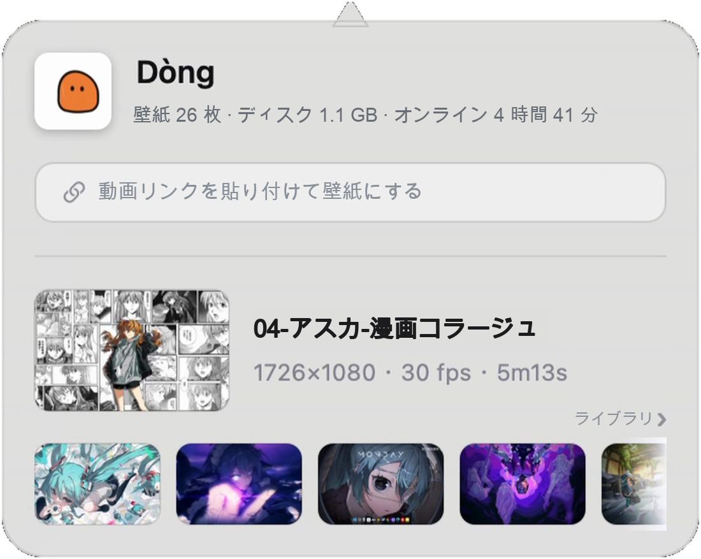
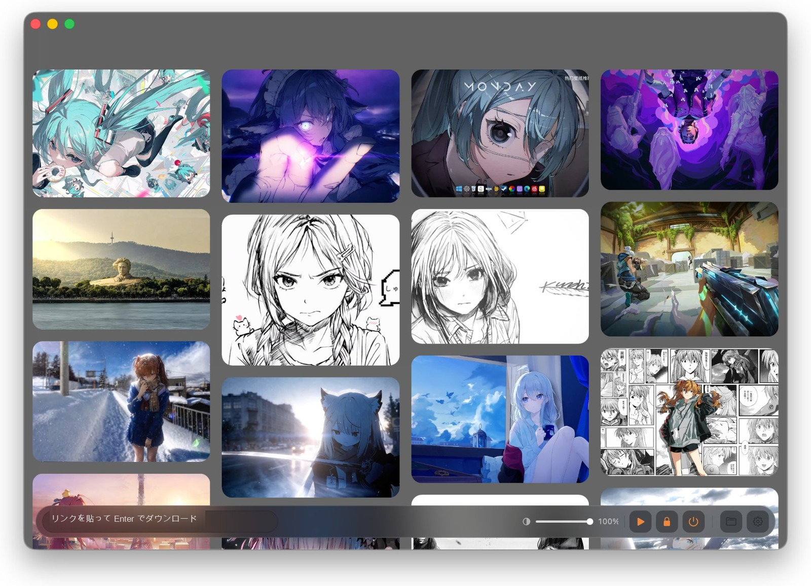

<div align="center">
  
  <h1><b>Dòng</b></h1>
  <p>どんな動画も、動くデスクトップに。<br>
  <a href="#機能"><strong>Dòng を見る »</strong></a><br><br>
  <a href="#インストール">macOS 版をダウンロード</a> · <a href="https://dongisgood.coze.site/en">公式サイト ↗</a><br>
  <a href="i18n/ja/AI_INSTALL_PROMPT.md"><strong>🤖 AI にインストールしてもらう（かんたん） »</strong></a><br>
  <i>~ バージョン 3.37 · macOS 13 以降 · Apple Silicon ~</i></p>
  <p>
    <a href="README.en.md">English</a> · <a href="README.zh.md">简体中文</a> · <b>日本語</b> · <a href="README.ko.md">한국어</a> · <a href="README.fr.md">Français</a><br>
    <a href="README.de.md">Deutsch</a> · <a href="README.es.md">Español</a> · <a href="README.it.md">Italiano</a> · <a href="README.ru.md">Русский</a>
  </p>
  <p><sub>このページの内容（スクリーンショット・リンク先の文書・プロンプト）はすべて日本語です。</sub></p>
</div>

> [!NOTE]
>
> Dòng は Swift と AppKit だけで書かれた macOS ライブ壁紙ツールです — 約 8,500 行のコード、サードパーティ製フレームワークはゼロ。
> Electron も SwiftUI も Pod もありません。
> 動画のリンクを貼るか、ローカルの動画をドラッグするだけ。ダウンロード、トリミング、継ぎ目のないループへの仕上げまで自動で行い、デスクトップに広げます。

<h6 align="center">
  <a href="i18n/ja/AI_INSTALL_PROMPT.md"></a>
  <a href="https://github.com/zhang-1-kael/dong/blob/main/LICENSE"></a>
  <a href="https://github.com/zhang-1-kael/dong/releases"></a>
  <a href="https://github.com/zhang-1-kael/dong"></a>
  <a href="https://github.com/zhang-1-kael/dong"></a>
  <a href="https://github.com/zhang-1-kael/dong/stargazers"></a>
  <a href="https://github.com/zhang-1-kael/dong/issues"></a>
</h6>

---

## 🤖 手作業は不要 —— これを AI に貼り付けるだけ

> [!IMPORTANT]
> **いちばんかんたんな導入方法：AI に一言お願いするだけ。** 下のブロックを丸ごとコピーし、Mac でコマンドを実行できる AI アシスタント（WorkBuddy、Claude Code、Cursor、Codex など）に貼り付けてください。
>
> 公式サイトから DMG をダウンロードし、SHA256 を検証し、「アプリケーション」にインストールし、macOS の初回起動時の確認も一度で済ませます。あとはダブルクリックで起動できます。
>
> ターミナルを開く必要も、システム設定を探す必要もありません。
>
> 下のプロンプトは、どの AI ツールでも読めるよう意図的に英語で書いてあります。最後の一行で日本語での返答を指定しているので、あなたが読む文章は日本語のままです。

**① 次のブロックを丸ごとコピー**

```text
Please install Dòng, a macOS live wallpaper app, on this Mac.

Official repo: https://github.com/zhang-1-kael/dong
Official site: https://dongisgood.coze.site/en
AI installation manual: AI_INSTALL.md in that repo; one-shot installer: install.sh

Please read the manual and the script first, then follow the manual: download from the official stable endpoint, verify the SHA256 from the official release endpoint, install into /Applications, complete macOS's one-time first-open confirmation, launch the app, and report the result plus how to use it.
Use only the official hosts above; no sudo, no deleting or overwriting my files, no changes to system-wide security settings. If you have no terminal access, just give me the shortest copy-pasteable commands — do not claim you installed anything.
Reply to me in Japanese.
```

**② AI に貼り付けて完了を待つだけ。初回起動時にアプリが出す「ライブ壁紙を有効にしますか」の選択は自分で行います。**

📖 関連ファイル：[AI 向け完全手順書](i18n/ja/AI_INSTALL.md) · [プロンプト集](i18n/ja/AI_INSTALL_PROMPT.md) · [インストールスクリプト](install.sh) · [公式サイトから手動ダウンロード](https://dongisgood.coze.site/en) · [日本語のドキュメント一覧](i18n/ja/GUIDE.md)

---

## 機能

### 🖥 デスクトップ級ライブ壁紙

WindowServer のデスクトップ層に枠なしウィンドウを置き、`AVPlayerLayer` でループ再生します。
システム壁紙は変更せず、カーネル拡張も不要、管理者権限も要りません。ディスプレイごとに独立したウィンドウとプレイヤーを持ち、ディスプレイの抜き差しで自動的に再構築されます。

### 🔗 リンク即壁紙

Bilibili / YouTube のリンクを貼るだけで、ダウンロード → トランスコード → 調整 → ライブラリ登録まで全自動。
Douyin のリンクはプラットフォームのスクレイピング対策で取得できません（[既知の制限](#既知の制限) を参照）。まず動画をローカルに保存してからドラッグしてください。

### ✂️ 自動でシームレスループに

ffmpeg で画面の「動き」を一次元の信号に変換し、信号の変位から本編の位置を特定。
明るさ・アスペクト比・エッジ密度からプラットフォームの透かしを特定し、`delogo` 補間で修復。
末尾と冒頭を 0.4 秒のクロスフェードでつなぎ、ループ点を完全に消し去ります。

### 🎛 メニューバーガラスパネル

常駐するメニューバーアプリ：現在の壁紙、ディスク使用量、オンライン時間、リンクを貼るだけでインポート。すべてのコントロールを AppKit で手描きしています。

<p align="center">
  
</p>

### 📚 ウォーターフォール壁紙ライブラリ

すべての壁紙をカバーグリッドで展開。ホバーでプレビュー、クリックで切り替え。音量、再生コントロール、現在のフレーム情報を一画面で。

<p align="center">
  
</p>

### 🔗 ロック画面と同じ絵柄

動画からフレームを切り出してシステム壁紙に設定 — ロック解除時は動き、ロック画面では同じ静止画。

---

## 使い方

### インストール

#### Dòng をダウンロード

[公式サイト](https://dongisgood.coze.site/en) から最新の `.dmg` をダウンロードし、開いて Dòng を「アプリケーション」にドラッグしてください。

このビルドは ad-hoc 署名で公証されていません。macOS に「壊れている」と言われたら、`xattr -dr com.apple.quarantine "/Applications/Dòng.app"` を一度実行してから開き直してください。

> [!TIP]
> **手作業が面倒なら AI に任せられます。** [AI_INSTALL_PROMPT.md](i18n/ja/AI_INSTALL_PROMPT.md) のプロンプトを任意の AI アシスタントに貼り付けるだけで、ダウンロードから検証・インストールまで自動でやってくれます。
>
> 自分でビルドしたい場合は以下の手順へ。必要なのは Xcode コマンドラインツールだけです。

#### ソースからビルド

**依存するのは Xcode コマンドラインツールのみ**。Xcode 本体は要りません：

```bash
xcode-select --install   # インストール済みならスキップ
```

クローンしてそのままコンパイル：

```bash
git clone https://github.com/zhang-1-kael/dong.git
cd dong
./build.sh
open build/VideoWallpaper.app
```

`build.sh` は一行の `swiftc` で 10 個の `.swift` ファイルを一つの実行ファイルにコンパイルし、`.app` に組み立てます。
ビルド生成物は **ad-hoc 署名** なので、自分のマシンでしか動きません。他人に配るには `sign-notarize.sh` を使ってください。

##### オプションコンポーネント

以下はコンパイルに必須ではありません。欠けていても該当機能が使えないだけです：

| コンポーネント | 役割 | 導入方法 |
|---|---|---|
| **ffmpeg** | トランスコード、冒頭と末尾のカット、透かし除去、ループ化 | `brew install ffmpeg`、または `~/.local/bin/ffmpeg` に配置 |
| **yt-dlp** | リンクのダウンロード | `brew install yt-dlp`、または実行ファイルを `vendor/yt-dlp_macos` に配置 |

`build.sh` は見つかった ffmpeg / yt-dlp を自動的に App パッケージに同梱するので、他人にコピーしても動きます。

> ⚠️ このリポジトリには**これら二つのバイナリも、内蔵の壁紙素材も含まれていません** — 下の[ライセンスと素材](#ライセンスと素材)を参照してください。

##### DMG にパッケージ

```bash
./package.sh                    # → dist/Dòng-<バージョン>.dmg
VW_NO_PRESETS=1 ./package.sh    # 内蔵壁紙なし。DMG が 360 MB 小さくなります
```

### 壁紙をインポートする

1. メニューバーの Dòng アイコンをクリックしてパネルを開く；
2. Bilibili / YouTube のリンクを入力欄に貼り付ける（共有テキストをそのまま貼っても大丈夫、アプリが自分でリンクを抽出します）、Enter；
3. またはローカルの動画ファイルを壁紙ライブラリウィンドウに直接ドラッグ；
4. 下部のカプセルが完了するのを待つ — 通常 20〜60 秒で壁紙が切り替わります。

---

## アーキテクチャ

「ウィンドウを持たないメニューバーアプリ」を中心とした四つの独立したパイプライン：

```
┌──────────────────────────────────────────────────────────────┐
│                  メニューバー App（LSUIElement）              │
│                                                              │
│  ① 表示層   デスクトップウィンドウ ×N  ──►  AVPlayerLayer  ──►  AVPlayerLooper│
│  ② 処理層   yt-dlp  ──►  ffmpeg トランスコード  ──►  ライブラリ│
│  ③ UI 層    メニューバーパネル / ライブラリウィンドウ（AppKit フル手描き）│
│  ④ システム層  LaunchAgent 自動起動 · ディレクトリ監視 · 匿名統計   │
└──────────────────────────────────────────────────────────────┘
```

| ファイル | 行数 | 役割 |
|---|---:|---|
| `main.swift` | 1 833 | 表示層：デスクトップウィンドウ、マルチディスプレイ、プレイヤーライフサイクル、自動更新の接続 |
| `LibraryWindow.swift` | 2 631 | 壁紙ライブラリウィンドウ、ウォーターフォールレイアウト + ホバープレビュー + 常駐の透明度スライダー |
| `Panel.swift` | 1 654 | メニューバーガラスパネル、ゼリーバッジアニメーション、すべて手描き |
| `Transcoder.swift` | 672 | プローブ、目標サイズ、冒頭と末尾の検出、透かし除去、エンコード |
| `Analytics.swift` | 534 | 匿名統計 + クラウドサービスアドレス（OFF にできます） |
| `Updater.swift` | 515 | 自動更新：確認、ダウンロード、SHA256 検証、その場で置き換え |
| `Downloader.swift` | 202 | yt-dlp ラッパーと進捗解析 |
| `FrameHealth.swift` | 320 | カクつきウォッチドッグと再生プローブ、diag.log に出力 |
| `LockScreen.swift` | 70 | フレームを切り出してシステム壁紙に設定 |
| `Presets.swift` | 47 | 内蔵素材の初回インポート |

**技術的な詳細はすべて [技術文書](i18n/ja/GUIDE.md)**：なぜウィンドウは画面より 24pt 大きくなければならないのか、
なぜ `--deep` 署名が有害なのか、なぜループ音声のミックスは三回に分けて seek しなければならないのか、
なぜ手描きのパネルはすりガラスを覆い隠してしまうのか — 踏んだ落とし穴はすべて記録されています。失敗した時のどこが間違っていたかも含めて。

---

## コマンドラインからのデバッグ

アルゴリズムを変えるたびにトランスコード完了まで待ちたくない人のために、headless（画面なし）デバッグ入口を用意しています：

```bash
VideoWallpaper --detect a.mp4             # 検出だけ実行。0.2 秒で冒頭/末尾/透かしの判定を出力
VideoWallpaper --try a.mp4 out.mp4        # 指定ファイルへ完全なトランスコードを一回実行
VideoWallpaper --import a.mp4 b.mp4       # まとめてインポートして結果を出力
VideoWallpaper --link "https://…"         # リンクのダウンロード + インポート
```

デバッグ用の環境変数は `GUIDE.md` の第 9 章を参照（`VW_PANEL_SHOT`、`VW_GEOM`、`VW_DUMP_MENU` など）。

---

## 既知の制限

| 制限 | 理由 |
|---|---|
| arm64 のみ | コンパイルターゲットも内蔵 ffmpeg も Apple Silicon。ユニバーサルバイナリにするには `lipo` が必要 |
| ロック画面は静止 | macOS はサードパーティにロック画面の動画を公開していません。フレーム切り出しは一線を越えない唯一の方法です |
| マルチディスプレイは同一動画を共有 | 画面ごとにプレイヤーは一つですが、ソースは同一ファイル |
| 更新は全自動 | 確認 → ダウンロード → SHA256 検証 → 終了後にその場で置き換えて再起動。インストールできない場合だけ dmg を開く方式にフォールバック |
| Douyin のリンクは非対応 | Douyin は `a_bogus` スクレイピング対策を採用しており、ログイン状態の cookie が必要。匿名リクエストは即拒否されます。まず App 内でローカルに保存してから、ファイルをドラッグしてください |
| リンクダウンロードには法の限界が | サードパーティのプラットフォームからコンテンツを取得する際は、権利を持つ素材のみを使ってください |

---

## プライバシー

App には匿名の使用統計を内蔵しています。**記録するもの**：ランダム生成されたインストール UUID、バージョン番号、OS バージョン、
CPU アーキテクチャ、言語、イベント名。

**記録しないもの**：ファイル名、ディレクトリパス、リンクの内容、壁紙の映像、個人を特定できるあらゆる情報。
設定でワンクリックで OFF にできます。OFF にするとローカルキューを即座に消去し、すべてのリクエストを停止します。

統計データは作者自身のサーバー（`Analytics.swift` にハードコードされたアドレス）に送信され、**デフォルトで ON** です。
**フォークして自分で配布する場合は、`Analytics.swift` 50 行目の `isEnabled` のデフォルト値を `false` に変更してください** —
そうしないとあなたのユーザーが作者のサーバーに報告してしまいます。これは行儀の良い話ではありませんが、はっきり言っておく必要があります。

---

## ライセンスと素材

コードとドキュメントは **GPL-3.0** の下で公開されています — [LICENSE](LICENSE) を参照。改変したバイナリを配布する場合は、完全な対応ソースコードを同じライセンスで提供する必要があります。

**デュアルライセンス：** Dòng をクローズドソースの商用製品に組み込みたい場合は、別途商用ライセンスをご利用いただけます — [GUIDE.md](i18n/ja/GUIDE.md) を参照するか、issue で作者にご連絡ください。

> **旧バージョンについて：** v3.31 以前は MIT ライセンスで公開されており、その許諾は取り消せません。GPL-3.0 はそれ以降のバージョンにのみ適用されます。

**ライセンスに含まれない部分：**

- 名称「Dòng」、`AppIcon.icns`、`BrandMark*.png` — ブランドマーク。派生作品の名前やアイコンに使わないでください。
- **壁紙素材**：`presets/` と `bili/` は `.gitignore` に入っており、リポジトリに動画ファイルはありません。
  自分でパッケージする素材の著作権は自己責任でお願いします。
- `ffmpeg` と `yt-dlp` のバイナリはリポジトリに含まれていません。注意：公式 ffmpeg の
  `--enable-gpl --enable-nonfree` ビルドは**再配布できません**。外部配布する場合は LGPL ビルドに切り替え、
  エンコーダーを `libx264` から `h264_videotoolbox` に変更してください。

---

## 作者について

I'm a 16-year-old high school sophomore. Dòng started as a whim — I wondered
why a wallpaper couldn't be a moving video, so I wrote one in Swift from
scratch, just for myself.

Then my classmates saw it and wanted it too. So I thought, why not build it
properly and share it. Getting from "it runs on my machine" to "it runs on
yours" meant figuring out downloads, transcoding, code signing, auto-updates —
none of which I had needed to care about before. It was a lot of reading docs
and hitting walls, one small fix at a time.

Now it's open source, and I'm sharing it with everyone. I hope you enjoy using
it — and if you run into any problems or have ideas, please open an issue.
I read every one.

---

<p align="center">
  <sub>Built with swiftc. No frameworks were harmed.</sub>
</p>
