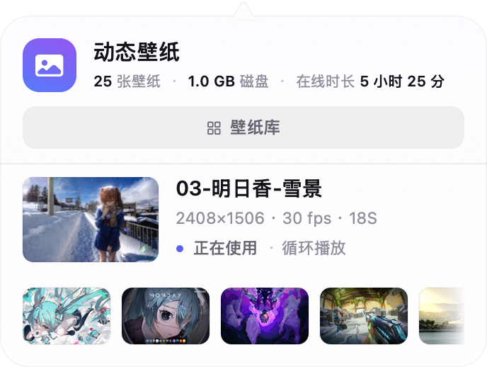

# Dòng

**一个纯原生 Swift 写的 macOS 动态壁纸 App。**
约 6 100 行代码，零第三方框架 —— 没有 Electron、没有 SwiftUI、没有一颗 Pod。

给它一个视频文件，或者一条网页链接，它会把片头片尾裁掉、去掉画面角标、
把首尾接成无缝循环，然后挂到桌面上循环播放。

<p align="center">
  
</p>

<p align="center">
  <code>macOS 13+</code> · <code>Apple Silicon</code> · <code>MIT</code> · <code>100% local</code>
</p>

---

## 它做了什么

| | |
|---|---|
| **真·动态桌面** | 在 WindowServer 的桌面层上挂一扇无边框窗口，用 `AVPlayerLayer` 播放。不改系统壁纸、不装内核扩展、不需要管理员权限 |
| **锁屏同款画面** | 抽一帧视频设为系统壁纸 —— 解锁时是动的，锁屏时是同一张静帧 |
| **一条链接直接入库** | 贴 B 站 / YouTube 链接，下载 → 转码 → 调优 → 入库全自动 |
| **自动剪片头片尾** | 用 ffmpeg 把画面「运动量」算成一维信号，在信号上找突变，判断哪里是正片 |
| **自动去角标** | 按白度、长宽比、边缘密度定位画面角落的平台水印，用 `delogo` 插值填补 |
| **无缝循环** | 片尾与片头做 0.4 秒交叉淡化，循环点彻底消失 |
| **多屏** | 每块屏幕独立窗口、独立播放器，插拔显示器自动重建 |

<p align="center">
  
</p>

---

## 构建

**依赖只有 Xcode 命令行工具**，不需要 Xcode 本体：

```bash
xcode-select --install   # 如果已经装过就跳过
```

克隆后直接编译：

```bash
git clone https://github.com/zhang-1-kael/dong.git
cd dong
./build.sh
open build/VideoWallpaper.app
```

`build.sh` 用一行 `swiftc` 把 8 个 `.swift` 文件编成一个可执行文件，再组装成 `.app`。
编译产物是 **ad-hoc 签名**，只能在你自己机器上跑；要分发给别人得走 `sign-notarize.sh`。

### 可选组件

下面两个都不是编译必需的，缺了只影响对应功能：

| 组件 | 作用 | 装法 |
|---|---|---|
| **ffmpeg** | 转码、剪片头片尾、去水印、做循环 | `brew install ffmpeg`，或放到 `~/.local/bin/ffmpeg` |
| **yt-dlp** | 粘贴链接下载 | `brew install yt-dlp`，或放可执行文件到 `vendor/yt-dlp_macos` |

`build.sh` 会自动把找到的 ffmpeg / yt-dlp 塞进 App 包里，这样拷给别人也能用。

> ⚠️ 本仓库**不包含**这两个二进制，也不包含内置壁纸素材 —— 见下方 [许可与素材](#许可与素材)。

### 打包成 DMG

```bash
./package.sh                    # → dist/Dòng-<版本>.dmg
VW_NO_PRESETS=1 ./package.sh    # 不带内置壁纸，DMG 小 360 MB
```

---

## 架构

四条独立的流水线，围绕一个「没有窗口的菜单栏 App」：

```
┌──────────────────────────────────────────────────────────────┐
│                     菜单栏 App（LSUIElement）                 │
│                                                              │
│  ① 显示层   桌面窗口 ×N 屏  ──►  AVPlayerLayer  ──►  AVPlayerLooper│
│  ② 处理层   yt-dlp  ──►  ffmpeg 转码  ──►  壁纸库             │
│  ③ 界面层   菜单栏面板 / 壁纸库窗口（AppKit 全自绘）           │
│  ④ 系统层   LaunchAgent 自启 · 目录监听 · 匿名统计             │
└──────────────────────────────────────────────────────────────┘
```

| 文件 | 行数 | 职责 |
|---|---:|---|
| `main.swift` | 1 308 | 显示层：桌面窗口、多屏、播放器生命周期 |
| `LibraryWindow.swift` | 2 118 | 壁纸库窗口，瀑布流布局 + 悬停预览 |
| `Panel.swift` | 1 476 | 菜单栏玻璃面板，全部自绘 |
| `Transcoder.swift` | 672 | 探测、目标尺寸、片头片尾检测、去水印、编码 |
| `Analytics.swift` | 276 | 匿名统计（可关） |
| `Downloader.swift` | 160 | yt-dlp 封装与进度解析 |
| `LockScreen.swift` | 70 | 抽帧设为系统壁纸 |
| `Presets.swift` | 47 | 内置素材首次导入 |

**完整的技术细节在 [`技术原理.md`](技术原理.md)**：为什么窗口要比屏幕大 24pt、
为什么 `--deep` 签名有害、为什么循环混音必须分三段 seek、
为什么面板自绘会把毛玻璃盖住 —— 每个坑都有记录，包括踩坑时错在哪。

---

## 命令行调试

不想每次改算法都等整个转码跑完，内置了无头（headless）调试入口：

```bash
VideoWallpaper --detect a.mp4             # 只跑检测，0.2 秒出片头/片尾/角标判定
VideoWallpaper --try a.mp4 out.mp4        # 跑一次完整转码到指定文件
VideoWallpaper --import a.mp4 b.mp4       # 批量导入并打印处理结果
VideoWallpaper --link "https://…"         # 链接下载 + 导入
```

调试用环境变量见 `技术原理.md` 第 9 节（`VW_PANEL_SHOT`、`VW_GEOM`、`VW_DUMP_MENU` 等）。

---

## 已知限制

| 限制 | 原因 |
|---|---|
| 仅 arm64 | 编译目标与内置 ffmpeg 都是 Apple Silicon；出通用二进制要 `lipo` |
| 锁屏是静止的 | macOS 不向第三方开放锁屏视频，抽帧是唯一不越界的做法 |
| 多屏共用同一视频 | 每屏一个播放器，但取自同一个文件 |
| 更新要手动拖 | 自己实现的更新检查：下载、校验 SHA256、打开 dmg，但不静默替换安装 |
| 不接抖音链接 | 抖音启用 a_bogus 反爬，必须带登录态 cookie，匿名请求直接被拒。请先在 App 里保存到本地，再把文件拖进来 |
| 链接下载有法律边界 | 抓取第三方平台内容，请只用于自己有权的素材 |

---

## 隐私

App 内置一份匿名使用统计，**只记录**：随机生成的安装 UUID、版本号、系统版本、
CPU 架构、语言、事件名。

**不记录**：文件名、目录路径、链接内容、壁纸画面、任何可识别个人的信息。
设置里可以一键关闭，关掉后立即清空本地队列并停止所有请求。

统计数据发往作者自己的服务器（`Analytics.swift` 里硬编码的地址）。
**如果你 fork 了并自己发行，请把 `Analytics.swift` 第 47 行 `isEnabled` 的默认值改成 `false`**，
否则你的用户会往作者的服务器上报 —— 这一步不体面，但必须说清楚。

---

## 许可与素材

代码与文档以 **MIT** 授权，见 [LICENSE](LICENSE)。

**不包含在授权里的部分：**

- 名称「Dòng」、`AppIcon.icns`、`BrandMark*.png` —— 品牌标识，请勿用于衍生作品的图标或名称。
- **壁纸素材**：`presets/` 与 `bili/` 已加入 `.gitignore`，仓库里没有视频文件。
  你自己打包时使用的素材，版权由你负责。
- `ffmpeg` 与 `yt-dlp` 二进制不在仓库内。注意：官方 ffmpeg 的
  `--enable-gpl --enable-nonfree` 构建**不可再分发**，对外分发应换 LGPL 构建
  并把编码器从 `libx264` 换成 `h264_videotoolbox`。

---

<p align="center">
  <sub>Built with swiftc. No frameworks were harmed.</sub>
</p>
