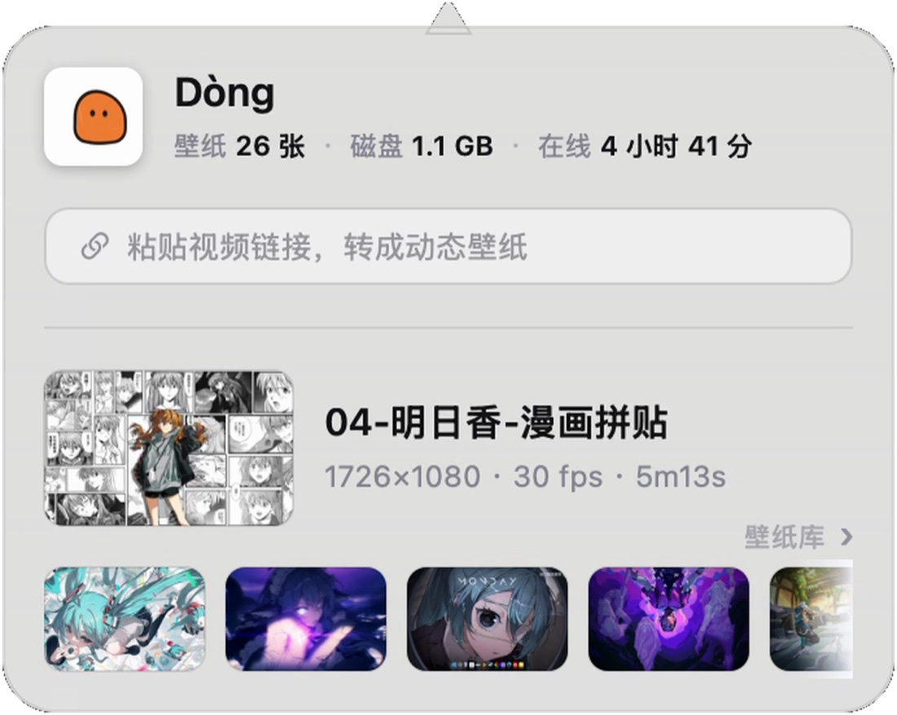
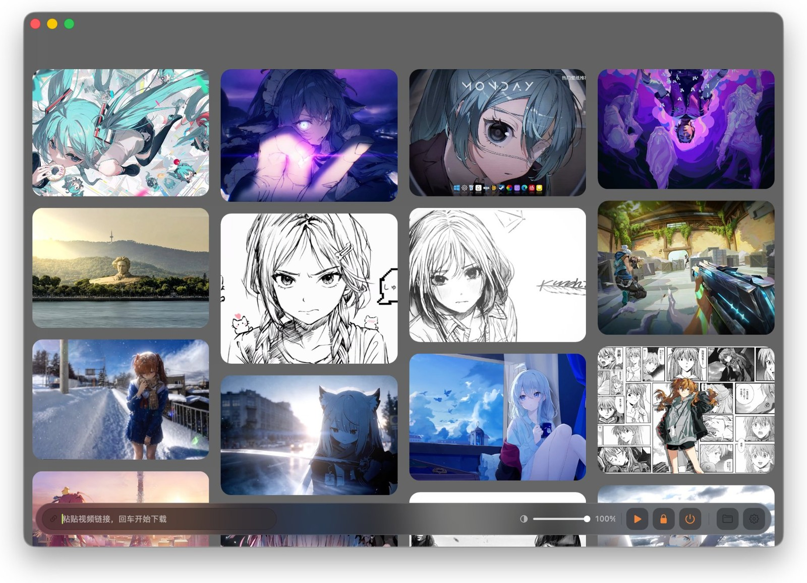

<div align="center">
  
  <h1><b>Dòng</b></h1>
  <p>Любое видео — живые обои.<br>
  <a href="#features"><strong>Посмотреть Dòng »</strong></a><br><br>
  <a href="#installation">Скачать для macOS</a> · <a href="https://dongisgood.coze.site/en">Официальный сайт ↗</a><br>
  <i>~ Версия 3.31 · macOS 13 и выше · Apple Silicon ~</i></p>
  <p>
    <a href="README.en.md">English</a> · <a href="README.zh.md">简体中文</a> · <a href="README.ja.md">日本語</a> · <a href="README.ko.md">한국어</a> · <a href="README.fr.md">Français</a><br>
    <a href="README.de.md">Deutsch</a> · <a href="README.es.md">Español</a> · <a href="README.it.md">Italiano</a> · <b>Русский</b>
  </p>
</div>

> [!NOTE]
>
> Dòng — инструмент живых обоев для macOS, полностью написанный на Swift и AppKit — около 8 500 строк кода, ноль сторонних фреймворков.
> Ни Electron, ни SwiftUI, ни одного Pod.
> Вставьте ссылку на видео или перетащите локальный файл: скачивание, обрезка и склейка в бесшовную петлю происходят автоматически и оказываются прямо на рабочем столе.

<h6 align="center">
  <a href="https://github.com/zhang-1-kael/dong/blob/main/LICENSE"></a>
  <a href="https://github.com/zhang-1-kael/dong/releases"></a>
  <a href="https://github.com/zhang-1-kael/dong"></a>
  <a href="https://github.com/zhang-1-kael/dong"></a>
  <a href="https://github.com/zhang-1-kael/dong/stargazers"></a>
  <a href="https://github.com/zhang-1-kael/dong/issues"></a>
</h6>

<a id="features" name="features"></a>

## Возможности

### 🖥 Живые обои уровня рабочего стола

Окно без рамки на desktop-слое WindowServer, зацикленное через `AVPlayerLayer`.
Системные обои не трогаются, ядровые расширения не нужны, права администратора не нужны. У каждого экрана свое окно и свой плеер; при подключении и отключении мониторов окна перестраиваются автоматически.

### 🔗 Ссылка → обои

Вставьте ссылку с Bilibili / YouTube — и вся цепочка: скачивание, транскодирование, подгонка, добавление в библиотеку — работает автоматически.
Ссылки на Douyin блокируются антискрейпингом платформы (см. [Известные ограничения](#известные-ограничения)); сначала сохраните видео локально, затем перетащите файл.

### ✂️ Автоматическая бесшовная петля

ffmpeg превращает «движение» в кадре в одномерный сигнал; скачки сигнала указывают, где начинается основной контент.
Водяные знаки платформ находятся по белизне, соотношению сторон и плотности краёв, затем затираются интерполяцией `delogo`.
Кроссфейд 0,4 секунды между концом и началом полностью убирает точку склейки.

### 🎛 Стеклянная панель в строке меню

Постоянный резидент в строке меню: текущие обои, занятое место на диске, время онлайн, вставили ссылку — импорт пошёл. Все элементы управления нарисованы вручную на AppKit.

<p align="center">
  
</p>

### 📚 Библиотека обоев

Все обои сеткой обложек; наведите — предпросмотр, щёлкните — переключение. Громкость, управление воспроизведением, информация о текущем кадре — всё на одном экране.

<p align="center">
  
</p>

### 🔒 Тот же кадр на экране блокировки

Возьмите кадр из видео и поставьте системные обои — при разблокировке движение, при блокировке тот же самый стоп-кадр.

---

## Использование

<a id="installation" name="installation"></a>

### Установка

#### Скачать Dòng

Возьмите свежий `.dmg` на странице [Releases](https://github.com/zhang-1-kael/dong/releases), откройте и перетащите Dòng в «Программы».

> [!TIP]
> Первый официальный релиз сейчас в сборке. Пока он не вышел, можете собрать сами из исходников по шагам ниже — нужны только командные инструменты Xcode, установка занимает минуту.

#### Сборка из исходников

**Единственная зависимость — командные инструменты Xcode**, сам Xcode не нужен:

```bash
xcode-select --install   # пропустите, если уже установлены
```

Клонируйте и сразу компилируйте:

```bash
git clone https://github.com/zhang-1-kael/dong.git
cd dong
./build.sh
open build/VideoWallpaper.app
```

`build.sh` одной строкой `swiftc` компилирует 10 файлов `.swift` в один исполняемый файл и собирает из него `.app`.
Сборка подписана **ad-hoc** и работает только на вашей машине; для распространения другим идите через `sign-notarize.sh`.

##### Необязательные компоненты

Для компиляции ни один не обязателен — без нужного просто отключится соответствующая функция:

| Компонент | Назначение | Установка |
|---|---|---|
| **ffmpeg** | Транскодирование, резка начала и конца, удаление водяных знаков, петля | `brew install ffmpeg`, либо положите в `~/.local/bin/ffmpeg` |
| **yt-dlp** | Скачивание по ссылкам | `brew install yt-dlp`, либо положите исполняемый файл в `vendor/yt-dlp_macos` |

`build.sh` автоматически упаковывает найденные ffmpeg / yt-dlp в комплект приложения, так что оно работает и после копирования на другую машину.

> ⚠️ В этом репозитории **нет ни этих двух бинарников, ни встроенных материалов для обоев** — см. [Лицензия и материалы](#лицензия-и-материалы).

##### Упаковка в DMG

```bash
./package.sh                    # → dist/Dòng-<версия>.dmg
VW_NO_PRESETS=1 ./package.sh    # без встроенных обоев, DMG меньше на 360 МБ
```

### Импорт обоев

1. Нажмите значок Dòng в строке меню, чтобы открыть панель;
2. Вставьте ссылку с Bilibili / YouTube в поле (можно целый текст пересылки — программа сама вытащит ссылку), нажмите Enter;
3. Или перетащите локальный видеофайл прямо в окно библиотеки;
4. Дождитесь, пока пробежит пилюля внизу — обычно 20–60 секунд, и обои поменяются.

---

## Архитектура

Четыре независимых конвейера вокруг «приложения в строке меню без окна»:

```
┌──────────────────────────────────────────────────────────────┐
│               Приложение в строке меню (LSUIElement)         │
│                                                              │
│  ① Отображение  Окна рабочего стола ×N  ──►  AVPlayerLayer  ──►  AVPlayerLooper │
│  ② Конвейер     yt-dlp  ──►  транскод ffmpeg  ──►  Библиотека │
│  ③ Интерфейс    Панель меню / окно библиотеки (всё на AppKit) │
│  ④ Система      Автостарт LaunchAgent · слежение за папкой · статистика │
└──────────────────────────────────────────────────────────────┘
```

| Файл | Строки | Назначение |
|---|---:|---|
| `main.swift` | 1 833 | Слой отображения: окна рабочего стола, несколько экранов, жизненный цикл плеера, подключение автообновления |
| `LibraryWindow.swift` | 2 631 | Окно библиотеки, каскадная раскладка + предпросмотр при наведении + постоянный ползунок прозрачности |
| `Panel.swift` | 1 654 | Стеклянная панель в строке меню, анимация желейного значка, всё нарисовано вручную |
| `Transcoder.swift` | 672 | Анализ, целевой размер, поиск начала и конца, удаление водяных знаков, кодирование |
| `Analytics.swift` | 534 | Анонимная статистика + адрес облачного сервиса (отключается) |
| `Updater.swift` | 515 | Автообновление: проверка, скачивание, проверка SHA256, замена на месте |
| `Downloader.swift` | 202 | Обёртка yt-dlp и разбор прогресса |
| `FrameHealth.swift` | 320 | Сторож подтормаживаний и зонды воспроизведения, пишет diag.log |
| `LockScreen.swift` | 70 | Взять кадр и поставить системные обои |
| `Presets.swift` | 47 | Первичный импорт встроенных материалов |

**Полное техническое описание — в [`技术原理.md`](技术原理.md) (на китайском)**: почему окно должно быть на 24pt больше экрана,
почему подпись `--deep` вредна, почему микширование звука петли должно делать seek тремя отрезками,
почему нарисованная вручную панель перекрывает матовое стекло — каждая ловушка задокументирована, вместе с ошибкой, которая к ней привела.

---

## Отладка из командной строки

Не хотите ждать полного транскодирования при каждой правке алгоритма? Есть встроенный headless-вход:

```bash
VideoWallpaper --detect a.mp4             # только анализ: вердикт по началу/концу/знаку за 0,2 с
VideoWallpaper --try a.mp4 out.mp4        # один полный транскод в указанный файл
VideoWallpaper --import a.mp4 b.mp4       # пакетный импорт с выводом результатов
VideoWallpaper --link "https://…"         # скачивание по ссылке + импорт
```

Переменные окружения для отладки — в разделе 9 `技术原理.md` (`VW_PANEL_SHOT`, `VW_GEOM`, `VW_DUMP_MENU` и другие).

---

## Известные ограничения

| Ограничение | Причина |
|---|---|
| Только arm64 | И цель компиляции, и встроенный ffmpeg — Apple Silicon; универсальный бинарник требует `lipo` |
| Экран блокировки статичен | macOS не открывает видео на экране блокировки третьим сторонам; стоп-кадр — единственный способ не перейти черту |
| Несколько экранов делят одно видео | На каждый экран плеер, но из одного файла |
| Обновления полностью автоматические | Проверка → скачивание → проверка SHA256 → замена на месте и перезапуск при выходе; открытие dmg — только если установка не удалась |
| Нет ссылок на Douyin | Douyin применяет антискрейпинг `a_bogus` и требует cookie с авторизацией; анонимные запросы отвергаются сразу. Сначала сохраните видео в приложении, затем перетащите файл |
| У скачивания по ссылкам есть правовые границы | При получении контента с чужих платформ используйте только то, на что у вас есть права |

---

## Конфиденциальность

В приложении есть анонимная статистика использования. **Записывается**: случайно сгенерированный UUID установки, номер версии, версия системы,
архитектура процессора, язык, имя события.

**Не записывается**: имена файлов, пути к папкам, содержимое ссылок, изображения обоев, всё, что идентифицирует личность.
В настройках отключается одним щелчком; отключение сразу очищает локальную очередь и останавливает все запросы.

Статистика уходит на сервер автора (адрес зашит в `Analytics.swift`) и **включена по умолчанию**.
**Если вы делаете форк и выпускаете свою сборку, поменяйте значение `isEnabled` в строке 50 `Analytics.swift` на `false`** —
иначе ваши пользователи будут отчитываться на сервер автора. Этот шаг невежлив, но сказать о нём надо прямо.

---

## Лицензия и материалы

Код и документация распространяются по лицензии **GPL-3.0** — см. [LICENSE](LICENSE). При распространении изменённого бинарного файла необходимо предоставить полный соответствующий исходный код на тех же условиях.

**Двойное лицензирование:** Для использования Dòng в закрытом коммерческом продукте доступна отдельная коммерческая лицензия — см. [COMMERCIAL.md](COMMERCIAL.md) или откройте issue для связи с автором.

> **Историческая справка:** версии v3.31 и ранее были выпущены под лицензией MIT. Эти права не могут быть отозваны; GPL-3.0 применяется только к более поздним версиям.

**Что лицензией не покрыто:**

- Название «Dòng», `AppIcon.icns`, `BrandMark*.png` — брендовые знаки; пожалуйста, не используйте их в названиях и иконках производных работ.
- **Материалы обоев**: `presets/` и `bili/` в `.gitignore`, в репозитории видеофайлов нет.
  Права на материалы, которыми вы упаковываете сборку сами, — на вашей ответственности.
- Бинарники `ffmpeg` и `yt-dlp` в репозитории отсутствуют. Внимание: официальные сборки ffmpeg с
  `--enable-gpl --enable-nonfree` **нельзя распространять**; для распространения берите сборку LGPL
  и меняйте кодировщик с `libx264` на `h264_videotoolbox`.

---

## About

I'm a 16-year-old high school sophomore. Dòng started as a whim — I wondered
why a wallpaper couldn't be a moving video, so I wrote one in Swift from
scratch, just for myself.

Then my classmates saw it and wanted it too. So I thought, why not build it
properly and share it. Getting from "it runs on my machine" to "it runs on
yours" meant figuring out downloads, transcoding, code signing, auto-updates —
none of which I had needed to care about before. It was a lot of reading docs
and hitting walls, one small fix at a time.

Now it's open source, and I'm sharing it with everyone. I hope you enjoy using
it — and if you run into any problems or have ideas, please open an issue.
I read every one.

---

<p align="center">
  <sub>Built with swiftc. No frameworks were harmed.</sub>
</p>
